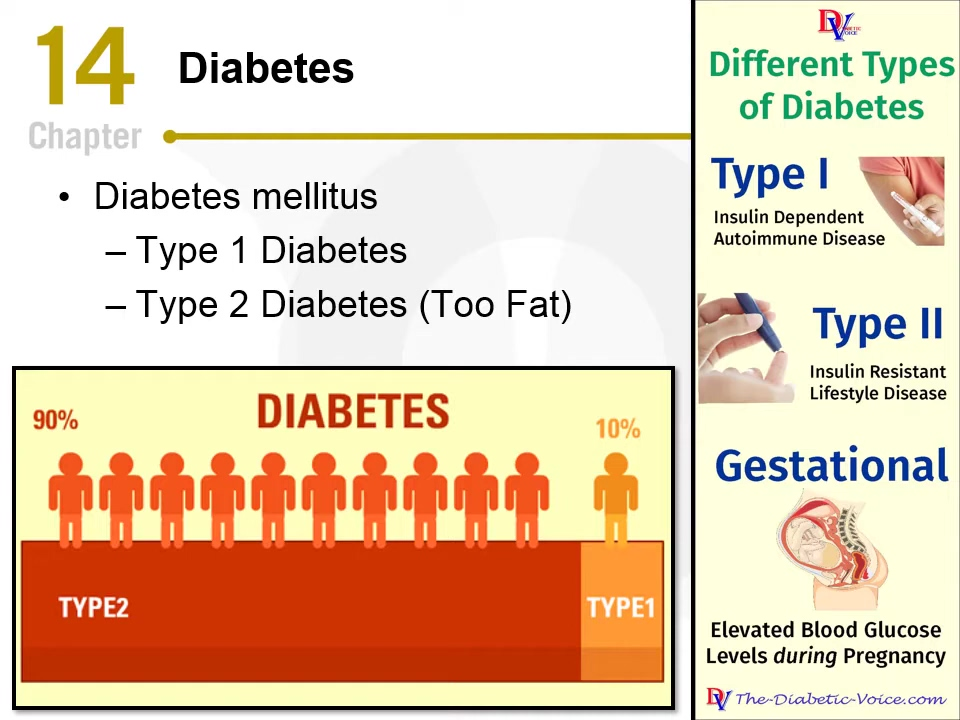
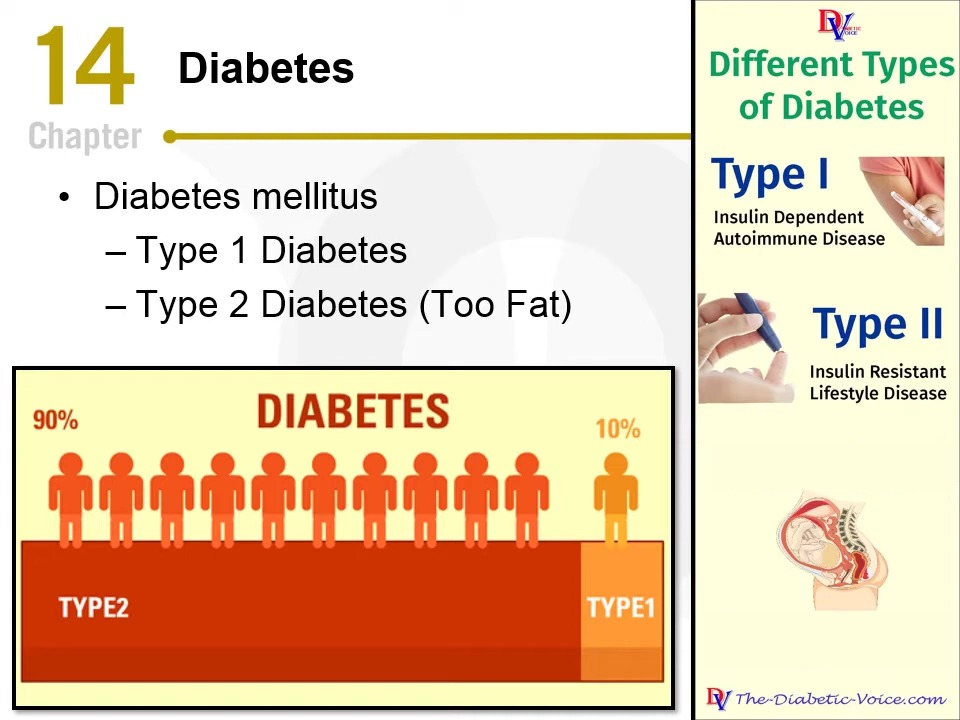
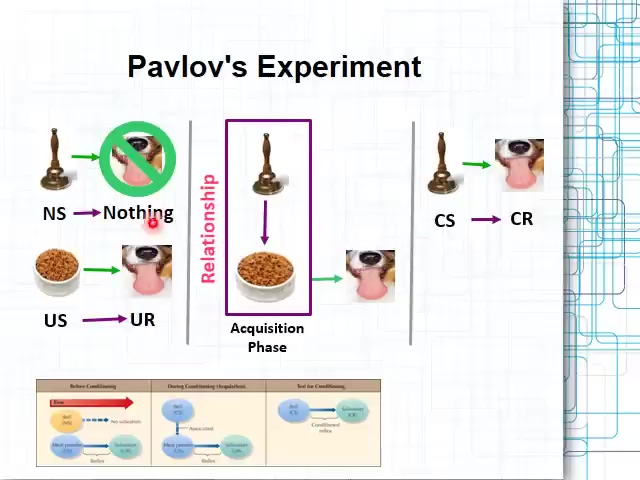

# Slide–Narration Relation Annotation (SNRA) Manual

## Contents

- [1. Purpose of this annotation](#sec-1)
- [2. How to proceed](#sec-2)
  - [2.1 Information provided](#sec-2-1)
  - [2.2 Work procedure](#sec-2-2)
  - [2.3 When you cannot make a judgment](#sec-2-3)
- [3. Label definitions and decision criteria](#sec-3)
  - [3.1 on_slide_textual_content / on_slide_visual_content](#sec-3-1)
  - [3.2 implicit_lecture_content](#sec-3-2)
  - [3.3 metadiscourse](#sec-3-3)
  - [3.4 unrelated_content](#sec-3-4)
  - [3.5 invalid_nu](#sec-3-5)
  - [3.6 Difficult cases](#sec-3-6)
- [4. Worked examples](#sec-4)
  - [4.1 Worked example for one slide](#sec-4-1)
  - [4.2 An NU that mixes on_slide_visual_content and implicit_lecture_content](#sec-4-2)

## 1. Purpose of this annotation

Lecture slides usually present content in a concise form. The speaker does not only read out or paraphrase the slide text, but also explains figures and tables, adds information that helps the audience understand the topic, and manages the progress of the lecture. The speaker may also talk about content unrelated to the slide.

This annotation aims to clarify the relationship between the lecture speech and the content shown on the slides. The resulting data will be used for the analysis of Implicit Lecture Content (ILC: information that is not directly shown on the **current** slide but helps the audience understand a topic on that slide) and for research on generating lecture narration that adds such helpful information.

## 2. How to proceed

### 2.1 Information provided

The following information is provided.

<table width="100%"><tr><td>
<ol>
<li>The lecture video</li>
<li>The image of the current slide</li>
<li>The narration while that slide is shown (a transcript of the speaker's speech)</li>
<li>The list of Narration Units</li>
</ol>
</td></tr></table>

A Narration Unit (NU) is a unit of speech obtained by dividing the narration by explanation point or discourse act (such as a question or a change of topic). The NU is the unit to which you assign labels in this annotation.

**Example:**

<table width="100%">
<tr>
<td width="50%" valign="top"></td>
<td width="50%" valign="top"><b>Full narration</b>  
when it comes to diabetes most of us know there are two types type 1 type 2 the way i always remember type 2 is that you're too fat and it's more than just simply being too fat but that's what we tend to talk about and as you can see in the chart there's a lot more type 2 diabetes than there is type 1 now there is a third type of diabetes which is basically women who are pregnant who get elevated glucose levels during pregnancy but for most of us we tend to think of only type 1 and type 2 those of you who are going into the allied health fields you'll might even discuss up to five different types of diabetes but for us for this class type 1 type 2 and remember type 2 is because you're too fat as i always like to do give you a little hints to help you remember things  
<b>NU list</b> (choose one main label for each NU)  
u01: When it comes to diabetes, most of us know there are two types: type 1, type 2. 
<kbd>on_slide_textual_content</kbd> <kbd>on_slide_visual_content&nbsp;</kbd> 
<kbd>implicit_lecture_content</kbd> <kbd>&nbsp;&nbsp;&nbsp;&nbsp;&nbsp;metadiscourse&nbsp;&nbsp;&nbsp;&nbsp;&nbsp;&nbsp;</kbd> 
<kbd>&nbsp;&nbsp;&nbsp;unrelated_content&nbsp;&nbsp;&nbsp;&nbsp;</kbd> <kbd>&nbsp;&nbsp;&nbsp;&nbsp;&nbsp;&nbsp;&nbsp;invalid_nu&nbsp;&nbsp;&nbsp;&nbsp;&nbsp;&nbsp;&nbsp;</kbd>  
u02: The way I always remember type 2 is that you're too fat. 
<kbd>on_slide_textual_content</kbd> <kbd>on_slide_visual_content&nbsp;</kbd> 
<kbd>implicit_lecture_content</kbd> <kbd>&nbsp;&nbsp;&nbsp;&nbsp;&nbsp;metadiscourse&nbsp;&nbsp;&nbsp;&nbsp;&nbsp;&nbsp;</kbd> 
<kbd>&nbsp;&nbsp;&nbsp;unrelated_content&nbsp;&nbsp;&nbsp;&nbsp;</kbd> <kbd>&nbsp;&nbsp;&nbsp;&nbsp;&nbsp;&nbsp;&nbsp;invalid_nu&nbsp;&nbsp;&nbsp;&nbsp;&nbsp;&nbsp;&nbsp;</kbd>  
u03: And it's more than just simply being too fat, but that's what we tend to talk about. 
<kbd>on_slide_textual_content</kbd> <kbd>on_slide_visual_content&nbsp;</kbd> 
<kbd>implicit_lecture_content</kbd> <kbd>&nbsp;&nbsp;&nbsp;&nbsp;&nbsp;metadiscourse&nbsp;&nbsp;&nbsp;&nbsp;&nbsp;&nbsp;</kbd> 
<kbd>&nbsp;&nbsp;&nbsp;unrelated_content&nbsp;&nbsp;&nbsp;&nbsp;</kbd> <kbd>&nbsp;&nbsp;&nbsp;&nbsp;&nbsp;&nbsp;&nbsp;invalid_nu&nbsp;&nbsp;&nbsp;&nbsp;&nbsp;&nbsp;&nbsp;</kbd>  
…
</td>
</tr>
</table>

### 2.2 Work procedure

For each slide, work through the following steps.

<table width="100%"><tr><td>
<ol>
<li>While watching the lecture video, check the slide image, the narration, and the NUs, and make sure you fully understand the content of the slide and of each NU.</li>
<li>For each NU, choose the one main label (<code>label</code>) that best matches the main purpose or point of the NU. Depending on the main label, make additional entries (<a href="#sec-3">Section 3</a>).</li>
<li>If you cannot make a judgment, follow <a href="#sec-2-3">2.3</a>.</li>
</ol>
</td></tr></table>

### 2.3 When you cannot make a judgment

- If the slide image is unclear or incomplete and this affects your judgment of the relationship between the NU and the slide, leave `label` blank (`""`) and write the relevant part and the reason in `note`. If it does not affect your judgment, label the NU as usual.
- If you cannot understand the content of an NU even after checking the slide, the narration, and the lecture video, choose `invalid_nu` and write the reason in `note` ([3.5](#sec-3-5)).

## 3. Label definitions and decision criteria

Choose the main label according to the following principles.

1. Choose the one main label that best matches the main purpose or point of the NU (why the speaker is saying it, and what the speaker mainly wants to convey).
2. Judge the relationship to the slide using the current slide only.
3. Because the main aim of this research is the analysis of ILC (information that is not directly shown on the current slide but helps the audience understand a topic on that slide), `implicit_lecture_content` takes priority over the other main labels. If any part of an NU contains a supplement that is not shown on the slide, the main label is `implicit_lecture_content`.

### 3.1 on_slide_textual_content / on_slide_visual_content

#### 3.1.1 Definition

Choose one of these labels when the main point of the NU is to explain to the audience the content shown on the slide (that is, to convey knowledge about the lecture topic). This includes paraphrases that do not change the meaning and restatements of content already explained.

- `on_slide_textual_content`: explains content that can be understood by reading the text shown on the slide.
- `on_slide_visual_content`: explains content that requires looking at the structure of a figure or the content of an image to understand.

#### 3.1.2 Decision guidelines

- The content of the NU is mostly shown on the slide.
- If the NU restates the previous NU or content already explained, choose this label as well, as long as the content is mostly shown on the slide.

#### 3.1.3 Distinguishing on_slide_textual_content from on_slide_visual_content

The two labels are distinguished by **whether visual understanding is needed to understand the content of the NU**. The table below gives guidelines for each type of slide element.

| Element | Label |
|---|---|
| Titles, bullet points, sentences, formulas (including handwritten ones) | `on_slide_textual_content` |
| Tables | Standard tables made up of text and numbers: `on_slide_textual_content`. Tables that require understanding an image: `on_slide_visual_content` |
| Figures, flowcharts, graphs, images, etc. | If the information is conveyed mainly by text and can be understood by reading the text: `on_slide_textual_content`. If understanding the structure of the figure or the image is needed: `on_slide_visual_content` |

If an NU refers to several elements, choose the label according to the element that the NU mainly explains. For an example in which the judgment for the same NU changes depending on whether the content is shown on the slide as text or only as an image, see [u05 in 4.1](#ex-4-1-u05).

### 3.2 implicit_lecture_content

#### 3.2.1 Definition

Choose this label when the NU **adds information that is not shown on the current slide but helps the audience understand a topic on that slide**. Choose this label even when only part of the NU is a supplement (principle 3 at the beginning of [Section 3](#sec-3)). The part of the NU that is the supplement is called the "supplementary part", and the rest is called the "remaining part".

Even if the content is shown on a previous slide, treat it as a supplement if it is not shown on the current slide. You do not need to refer to previous slides.

#### 3.2.2 Decision guidelines

- The NU adds content that is not shown on the slide (an example, a reason, a condition, background, a method, etc.).
- That content helps the audience understand the topic. Even if removing a part would lose some content, do not treat it as a supplement if it is not information that helps the audience understand the topic (for example, the speaker expressing an attitude toward their own statement).

#### 3.2.3 Additional entries

1. `sublabel`: Choose from [3.2.4 Sublabel list](#sec-3-2-4) the one sublabel that best matches the role of the supplementary part. If the supplementary part spans several sublabels, choose the one that best matches the main purpose or point of the NU. If none applies, choose `other` and briefly write in `note` the sublabel you think is needed and the reason.
2. `not_on_slide_span` (supplementary part): Copy the supplementary part exactly as it appears in the NU text.
   - Decide the extent of the supplementary part by **whether removing that part would lose content that the audience receives**. Include parts whose removal would lose substantive information, such as examples, explanations, qualifications, or background. Do not include parts that only change the wording, such as paraphrases, repetitions, or hesitations.
   - Extract it in the shortest possible phrase or clause units. You may include elements attached to the supplementary part, such as articles, commas, and periods (strictness is not required).
   - If the supplementary part is split into several places, copy the shortest continuous span that includes all of them.
   - If the whole NU is a supplement, copy the whole NU.
3. `remainder_label` (main label of the remaining part): If the remaining part, without the supplementary part, still forms a meaningful sentence or phrase on its own, choose one main label for it from the four labels `on_slide_textual_content`, `on_slide_visual_content`, `metadiscourse`, and `unrelated_content`. Leave it blank (`""`) in the following cases.
   - The whole NU is a supplement.
   - No main label can be assigned to the remaining part.

#### 3.2.4 Sublabel list

Choose the sublabel according to the role that the supplementary part plays. Subtypes are a guide for choosing the sublabel and are not recorded.

<table>
<tr><th width="34%">Sublabel</th><th width="22%">Subtype</th><th width="44%">Description of the subtype</th></tr>
<tr><td rowspan="4"><b>Concept clarification</b> <code>concept_clarification</code>  Adds information that helps the audience understand a term or concept.  <b>Key point:</b> Focus on what the audience can come to understand about the meaning or features of a term or concept. Supplements that make a concept easier to understand through a definition or a detailed explanation belong here. If the supplement gives a concrete example, choose <code>example</code>.</td><td>Definition</td><td>Explains what a term means.</td></tr>
<tr><td>Attribute</td><td>Explains features of a concept or object.</td></tr>
<tr><td>Elaboration</td><td>Adds details needed for understanding to a brief explanation.</td></tr>
<tr><td>Misconception correction</td><td>Corrects a misunderstanding that is likely to arise about a concept.</td></tr>
<tr><td rowspan="2"><b>Example</b> <code>example</code>  Gives a concrete example that fits the content of the slide.  <b>Key point:</b> Focus on whether the supplement shows the content of the slide concretely by mentioning a particular person, situation, or event. When one example spans several NUs, or when the speaker links an example to the concept after giving it ("this is an instance of X"), choose this sublabel for those parts as well.</td><td>Example</td><td>Gives a concrete example that fits the concept. This includes examples that do not fit the concept (counterexamples).</td></tr>
<tr><td>Analogy</td><td>Explains a concept by comparing it to something familiar.</td></tr>
<tr><td rowspan="7"><b>Explanation and reasoning</b> <code>explanation_reasoning</code>  Explains why or how a phenomenon occurs, or what a result means.  <b>Key point:</b> Focus on whether the supplement explains "why it happens", "how it happens", or "what can be concluded from the result". Distinguish speech that only states a result from speech that also explains its reason or implication.</td><td>Cause</td><td>Shows a factor that produces a phenomenon or result.</td></tr>
<tr><td>Reason / Rationale</td><td>Shows why a claim, choice, or conclusion is justified.</td></tr>
<tr><td>Mechanism</td><td>Explains how several elements work together to produce a result.</td></tr>
<tr><td>Process</td><td>Explains in what order a phenomenon proceeds.</td></tr>
<tr><td>Result / Consequence</td><td>Shows a result or effect produced by an event or action.</td></tr>
<tr><td>Implication</td><td>Shows what further follows from a fact or result.</td></tr>
<tr><td>Interpretation</td><td>Explains how to view a result and what it means.</td></tr>
<tr><td rowspan="5"><b>Contextual knowledge</b> <code>contextual_knowledge</code>  Adds outside knowledge or background information that helps the audience understand the current topic.  <b>Key point:</b> Focus on surrounding information that positions or supports the topic on the slide. Historical developments, facts obtained through observation or research, sources, and situations in which something is used belong here.</td><td>Background</td><td>Shows surrounding information for understanding the topic.</td></tr>
<tr><td>Historical development</td><td>Shows how a concept or method came about, or how a situation has changed over time.</td></tr>
<tr><td>Evidence</td><td>Shows observations or research findings that support a claim.</td></tr>
<tr><td>Source / Attribution</td><td>Shows the source of information, or the person or organization that proposed an idea.</td></tr>
<tr><td>Application / Use case</td><td>Shows in what situations or for what purposes a concept or method is used.</td></tr>
<tr><td rowspan="6"><b>Qualification and relation</b> <code>qualification_relation</code>  Adds the conditions or assumptions under which a claim or method holds, its relationship to other objects, or its limitations.  <b>Key point:</b> Focus on how the supplement clarifies the scope of a claim or method, or its relationship to other objects.</td><td>Condition</td><td>Shows a condition under which a claim or method holds.</td></tr>
<tr><td>Assumption</td><td>Shows what is assumed to hold in order to proceed with the explanation.</td></tr>
<tr><td>Prerequisite</td><td>Shows a condition that must be met before doing or understanding something.</td></tr>
<tr><td>Comparison</td><td>Compares several objects from a common viewpoint.</td></tr>
<tr><td>Contrast</td><td>Highlights differences between objects or methods.</td></tr>
<tr><td>Limitation / Caveat</td><td>Shows drawbacks or limits in interpreting or using something.</td></tr>
<tr><td rowspan="3"><b>Method and action</b> <code>method_action</code>  Explains the steps for carrying out a method, or concrete measures for solving a problem.  <b>Key point:</b> Focus on what is done in order to carry out a method or solve a problem. If the supplement describes how a natural phenomenon or a cognitive process proceeds, check whether it falls under "Explanation and reasoning".</td><td>Method / Approach</td><td>Shows a way of addressing a problem or goal.</td></tr>
<tr><td>Procedure / Step</td><td>Shows the actions and their order when carrying out a method.</td></tr>
<tr><td>Practical strategy</td><td>Shows how to respond to a situation, or measures for carrying out work more effectively.</td></tr>
<tr><td><b>Prior content recall</b> <code>prior_content_recall</code>  A supplement that restates content already explained in the lecture.  <b>Key point:</b> Choose this when you can judge from the current slide and the wording of the NU that the speaker is restating content already explained. You do not need to refer to previous slides.</td><td>(No subtypes)</td><td>Examples of cues: the slide starts in the middle of a procedure (for example, from "Step #3"); the NU contains expressions such as "once you have ~" or "as I mentioned". If there are no cues and you cannot judge, choose another sublabel according to the content.</td></tr>
<tr><td><b>Other</b> <code>other</code>  Use when none of the existing sublabels can express the role of the supplementary part.</td><td>Free description</td><td>Briefly write in <code>note</code> the sublabel you think is needed and the reason.</td></tr>
</table>

### 3.3 metadiscourse

#### 3.3.1 Definition

Choose this label for speech whose main purpose is to show the structure or progress of the lecture, to show the speaker's attitude toward or evaluation of what is being said, or to engage the audience. It does not convey knowledge about the lecture topic.

#### 3.3.2 Decision guidelines

- The NU introduces a topic to be covered, or marks a break in the explanation or a change of topic.
- The NU explicitly states that the explanation is at the stage of summarizing its main points, as in "Let me summarize the main points so far."
- The NU directs the audience to look at reference materials shown on the slide (a video, a URL, etc.).
- The speaker shows confidence, attitude, evaluation, or their own position regarding what is being said.
- The NU refers to an understanding shared with the audience, or checks whether the audience understands.

#### 3.3.3 Additional entries

`sublabel`: Choose from [3.3.4 Sublabel list](#sec-3-3-4) the one sublabel that best matches the main purpose or point of the NU. If none applies, choose `other` and briefly write in `note` the sublabel you think is needed and the reason.

#### 3.3.4 Sublabel list

Subtypes are a guide for choosing the sublabel and are not recorded.

<table>
<tr><th width="28%">Sublabel</th><th width="24%">Subtype</th><th width="48%">Description of the subtype</th></tr>
<tr><td rowspan="15"><b>Organization and management</b> <code>organization_management</code>  Shows the structure and order of the lecture or presentation, and guides changes of topic and the progress of the lecture.</td><td>Opening</td><td>Marks the start of the lecture or presentation.</td></tr>
<tr><td>Closing</td><td>Marks the end of the whole lecture or presentation.</td></tr>
<tr><td>Topic introduction</td><td>Shows a topic to be covered.</td></tr>
<tr><td>Goal announcement</td><td>Shows the purpose of the lecture or of a section.</td></tr>
<tr><td>Sequencing</td><td>Shows the order of explanation.</td></tr>
<tr><td>Transition</td><td>Marks a change of the item or section being explained.</td></tr>
<tr><td>Previewing</td><td>Announces content to be covered later.</td></tr>
<tr><td>Reviewing</td><td>Looks back on content already covered.</td></tr>
<tr><td>Summarizing</td><td>Shows that the explanation is at the stage of summarizing its main points.</td></tr>
<tr><td>Concluding</td><td>Wraps up a topic or section.</td></tr>
<tr><td>Endophoric reference</td><td>Refers to a part of the lecture or materials that has already been covered or will be covered.</td></tr>
<tr><td>Aside</td><td>Shows that the speaker is temporarily leaving the main topic.</td></tr>
<tr><td>Returning to topic</td><td>Shows a return to the main topic.</td></tr>
<tr><td>Task / Schedule management</td><td>Gives notices about assignments or schedules.</td></tr>
<tr><td>Time management</td><td>Adjusts the progress according to the remaining time or time allocation.</td></tr>
<tr><td rowspan="7"><b>Speaker stance</b> <code>speaker_stance</code>  Shows how confident the speaker is about what is being said, what attitude or evaluation the speaker shows, and how far the speaker commits to a statement.</td><td>Hedge / Uncertainty</td><td>Shows a modest degree of confidence.</td></tr>
<tr><td>Booster / Certainty</td><td>Shows strong confidence or emphasizes a claim.</td></tr>
<tr><td>Attitude / Evaluation</td><td>Shows an attitude toward or evaluation of the content.</td></tr>
<tr><td>Importance marking</td><td>Shows that a point is important for the explanation.</td></tr>
<tr><td>Difficulty marking</td><td>Shows how easy or difficult the content is to understand.</td></tr>
<tr><td>Self-positioning</td><td>Shows from what position the speaker is speaking.</td></tr>
<tr><td>Limiting commitment</td><td>Shows how far the speaker can commit to a statement.</td></tr>
<tr><td rowspan="11"><b>Audience interaction</b> <code>audience_interaction</code>  Engages the audience directly to draw their attention, check their understanding, or encourage their participation.</td><td>Direct address</td><td>Addresses the audience directly.</td></tr>
<tr><td>Attention directing</td><td>Draws the audience's attention to a particular explanation or part of the materials.</td></tr>
<tr><td>Comprehension check</td><td>Checks whether the audience understands.</td></tr>
<tr><td>Channel check</td><td>Checks whether the audio can be heard or the materials can be seen.</td></tr>
<tr><td>Question / Invitation</td><td>Encourages a response by asking a question or inviting participation.</td></tr>
<tr><td>Directive / Request</td><td>Asks the audience to take an action.</td></tr>
<tr><td>Shared knowledge</td><td>Refers to knowledge shared with the audience.</td></tr>
<tr><td>Anticipating response</td><td>Mentions in advance a question or reaction the audience is likely to have.</td></tr>
<tr><td>Inclusive reference</td><td>Encourages participation through expressions that include the audience, such as "we".</td></tr>
<tr><td>Q&amp;A management</td><td>Runs the Q&amp;A, for example by taking questions.</td></tr>
<tr><td>Greeting / Thanks</td><td>Greets or thanks the audience.</td></tr>
<tr><td><b>Other</b> <code>other</code>  Use when none of the existing sublabels can express the function of the speech.</td><td>Free description</td><td>Briefly write in <code>note</code> the sublabel you think is needed and the reason.</td></tr>
</table>

### 3.4 unrelated_content

**Definition**

Choose this label for an NU whose meaning is clear but that does not convey knowledge about the lecture topic to the audience and does not fall under `metadiscourse` either (for example, "Nice weather today, isn't it?").

**Additional entries:** none.

### 3.5 invalid_nu

**Definition**

Choose this label when you cannot understand what the NU says even after checking the slide, the narration, and the lecture video (for example, the speech breaks off partway and does not make sense).

**Additional entries:** briefly write in `note` why you cannot understand the NU.

### 3.6 Difficult cases

#### 3.6.1 Difficult cases for main labels

- **One NU contains content corresponding to several main labels**
  - If it contains a supplement that is not shown on the slide, the main label is `implicit_lecture_content`, as stated in principle 3 at the beginning of [Section 3](#sec-3), and the main label of the remaining part is entered in `remainder_label` (examples: [u03 in 4.1](#ex-4-1-u03), [u02 in 4.2](#ex-4-2-u02)).
  - If it contains no supplement (for example, it contains content shown on the slide together with an expression that introduces the talk or shows the speaker's attitude), choose the one main label that best matches the main purpose or point of the NU (example: [u01 in 4.1](#ex-4-1-u01)).
- **A word in the NU is on the slide, but the NU only introduces the topic**
  - Judgment: `organization_management` of `metadiscourse` (subtype: Topic introduction)
  - Example: Next, let's talk about diabetes.
  - Reason: The NU contains a word shown on the slide, but it only introduces that word as the next topic and does not convey knowledge about the lecture topic.
- **The NU clearly marks a break in the explanation or a change of topic**
  - Judgment: `organization_management` of `metadiscourse` (subtype: Transition)
  - Example: "In this slide, I explained XXX. Next, I will talk about YYY."
  - Reason: Even if XXX is shown on the slide, do not choose `on_slide_textual_content` or `on_slide_visual_content`. The main point of the speech is to mark a break in the explanation or a change of topic, so choose `metadiscourse`.
- **After talking about something else, the speaker restates content already explained**
  - Judgment: `on_slide_textual_content` if the content is mostly shown on the slide
  - Example: [u08 in 4.1](#ex-4-1-u08)
  - Reason: An opening expression such as "But for us, for this class," alone cannot be said to clearly mark a break in the explanation or a change of topic.
- **The NU directs the audience to reference materials**
  - Judgment: `audience_interaction` of `metadiscourse` (subtype: Attention directing)
  - Example: If you want to know more about diabetes, check the URL below. (A link is shown at the bottom of the slide.)
  - Reason: The NU refers to a link shown on the slide, but it does not convey knowledge about the lecture topic, so choose `metadiscourse`.
- **The NU refers to content already explained, as in "as I explained earlier"**
  - Judgment: If the NU does not state the explained content itself, `organization_management` of `metadiscourse` (subtype: Reviewing). If it restates the explained content itself and that content is not shown on the current slide, `prior_content_recall` of `implicit_lecture_content` ([3.6.2](#sec-3-6-2)).
- **The NU relates to an image, but the image alone does not cover its content**
  - Judgment: `implicit_lecture_content`. For the part that explains the figure or image, set `remainder_label` to `on_slide_visual_content`.
  - Examples: [u02 in 4.2](#ex-4-2-u02); the "Reference" under [u05 in 4.1](#ex-4-1-u05) (the slide with the text removed from the figure on the right)
- **The NU explains text that forms part of a figure**
  - Judgment: `on_slide_visual_content` if the text cannot be understood without looking at the structure of the figure
  - Example: the first half of [u02 in 4.2](#ex-4-2-u02) ("NS → Nothing" is understood together with the bell image, the arrow, and the dog image with a prohibition sign)

#### 3.6.2 Difficult cases for sublabels

- **The NU restates content already explained that is not shown on the current slide**
  - Judgment: `prior_content_recall` of `implicit_lecture_content`
  - Example: As I mentioned earlier, insulin is the hormone that helps sugar move from the blood into our cells.
  - Reason: The word "Insulin" is shown on the slide, but the function of insulin is not. From the expression "As I mentioned earlier", you can judge that the speaker is restating content already explained. You do not need to refer to previous slides.
- **The NU refers to an understanding shared with the audience**
  - Judgment: `audience_interaction` of `metadiscourse` (subtype: Shared knowledge)
  - Example: [u06 in 4.1](#ex-4-1-u06)
- **The speaker talks about their own way of teaching**
  - Judgment: `speaker_stance` of `metadiscourse` (subtype: Self-positioning)
  - Example: [u09 in 4.1](#ex-4-1-u09)

#### 3.6.3 Difficult cases for the supplementary part and remainder_label

- **The remaining part contains a word on the slide, but its main point is not to explain the content of the slide**
  - Judgment: Enter in `remainder_label` the main label that best matches the main purpose or point of the remaining part.
  - Example: [u03 in 4.1](#ex-4-1-u03) (And it's more than just simply being too fat, but that's what we tend to talk about.)
  - Reason: Without the supplementary part "more than just simply being too fat", the core of the remaining part is "but that's what we tend to talk about". This part refers to "Too Fat" on the slide, but it does not convey knowledge about type 2 diabetes; instead, the speaker is commenting on how people usually describe it ("too fat" is just how we usually talk about it). Therefore, `remainder_label` is `metadiscourse`, not `on_slide_textual_content`.
- **The supplementary part is split into several places**
  - Judgment: Enter as `not_on_slide_span` the shortest continuous span that includes all supplementary parts, and judge `remainder_label` based on the part outside that span.
  - Example: [u02 in 4.2](#ex-4-2-u02)
  - Reason: The supplement is split into two places: "it may twist his head, it may bark" and "Nothing means it doesn't give us the response we're looking for." The part between them, "but basically this neutral stimulus will lead to nothing.", explains "NS → Nothing" in the figure, but it lies within the shortest continuous span that includes both places, so it is copied as part of the supplementary part. The remaining part is the first half, "So the first thing ... it doesn't make saliva;", which explains the figure, so `remainder_label` is `on_slide_visual_content`.

## 4. Worked examples

This section gives worked examples. Each example shows the slide image at the top left and the NU list (the NU being judged is in bold) at the top right, followed by the NU being judged, the entries, and the reasons for the judgment. For examples with a sublabel, the reasons also show the subtype used as a reference for the judgment (subtypes are not recorded).

### 4.1 Worked example for one slide

This section shows all 9 NUs for one slide from the lecture used for the worked example (diabetes).

#### u01 in 4.1

**What to check in this example:** An NU that explains text elements on the slide

<table width="100%">
<tr>
<td width="50%" valign="top"></td>
<td width="50%" valign="top"><b>NU list</b> (the NU being judged is in bold)  
<b>u01: when it comes to diabetes most of us know there are two types type 1 type 2</b> 
u02: the way i always remember type 2 is that you're too fat 
u03: and it's more than just simply being too fat but that's what we tend to talk about and 
u04: as you can see in the chart there's a lot more type 2 diabetes than there is type 1 
u05: now there is a third type of diabetes which is basically women who are pregnant who get elevated glucose levels during pregnancy 
u06: but for most of us we tend to think of only type 1 and type 2 
u07: those of you who are going into the allied health fields you'll might even discuss up to five different types of diabetes 
u08: but for us for this class type 1 type 2 and remember type 2 is because you're too fat 
u09: as i always like to do give you a little hints to help you remember things
</td>
</tr>
</table>

**NU being judged:** `example_s011_u01`

> When it comes to diabetes, most of us know there are two types: type 1, type 2.

**Entries:**

- `label`: `on_slide_textual_content`

**Reasons:**

- This NU says that there are two types of diabetes: type 1 and type 2.
- It explains the content shown in the bullet points on the slide (Type 1 Diabetes, Type 2 Diabetes). The opening "most of us know" only introduces the talk, and the main point of the speech is to explain the two types ([3.6.1](#sec-3-6-1)).
- The content can be understood by reading the text of the bullet points, so choose `on_slide_textual_content`.

#### u02 in 4.1

**What to check in this example:** An NU that takes the form of the speaker's own mnemonic but explains text elements on the slide

<table width="100%">
<tr>
<td width="50%" valign="top"></td>
<td width="50%" valign="top"><b>NU list</b> (the NU being judged is in bold)  
u01: when it comes to diabetes most of us know there are two types type 1 type 2 
<b>u02: the way i always remember type 2 is that you're too fat</b> 
u03: and it's more than just simply being too fat but that's what we tend to talk about and 
u04: as you can see in the chart there's a lot more type 2 diabetes than there is type 1 
u05: now there is a third type of diabetes which is basically women who are pregnant who get elevated glucose levels during pregnancy 
u06: but for most of us we tend to think of only type 1 and type 2 
u07: those of you who are going into the allied health fields you'll might even discuss up to five different types of diabetes 
u08: but for us for this class type 1 type 2 and remember type 2 is because you're too fat 
u09: as i always like to do give you a little hints to help you remember things
</td>
</tr>
</table>

**NU being judged:** `example_s011_u02`

> The way I always remember type 2 is that you're too fat.

**Entries:**

- `label`: `on_slide_textual_content`

**Reasons:**

- This NU says that the speaker remembers type 2 as "too fat".
- It explains what "(Too Fat)" in the bullet point "Type 2 Diabetes (Too Fat)" stands for. It takes the form of the speaker's own mnemonic ("The way I always remember"), but what it conveys is "Too Fat" itself, which is shown on the slide.
- The content can be understood by reading the text of the bullet points, so choose `on_slide_textual_content`.

#### u03 in 4.1

**What to check in this example:** An NU that mixes a supplement with a part corresponding to `metadiscourse`

<table width="100%">
<tr>
<td width="50%" valign="top"></td>
<td width="50%" valign="top"><b>NU list</b> (the NU being judged is in bold)  
u01: when it comes to diabetes most of us know there are two types type 1 type 2 
u02: the way i always remember type 2 is that you're too fat 
<b>u03: and it's more than just simply being too fat but that's what we tend to talk about and</b> 
u04: as you can see in the chart there's a lot more type 2 diabetes than there is type 1 
u05: now there is a third type of diabetes which is basically women who are pregnant who get elevated glucose levels during pregnancy 
u06: but for most of us we tend to think of only type 1 and type 2 
u07: those of you who are going into the allied health fields you'll might even discuss up to five different types of diabetes 
u08: but for us for this class type 1 type 2 and remember type 2 is because you're too fat 
u09: as i always like to do give you a little hints to help you remember things
</td>
</tr>
</table>

**NU being judged:** `example_s011_u03`

> And it's more than just simply being too fat, but that's what we tend to talk about.

**Entries:**

- `label`: `implicit_lecture_content`
- `sublabel`: `concept_clarification`
- `not_on_slide_span`: more than just simply being too fat
- `remainder_label`: `metadiscourse`

**Reasons:**

- This NU says that type 2 diabetes is more than just simply being too fat, but that this is how we usually talk about it.
- The slide shows only "Too Fat"; it does not show that type 2 diabetes is more than just simply being too fat. This information helps the audience understand type 2 diabetes, so it is a supplement ([3.2](#sec-3-2)).
- `not_on_slide_span`: Following [3.2](#sec-3-2), the part whose removal would lose the content that type 2 is not caused only by being too fat is extracted as a phrase. The preceding "And it's" is not included because it does not affect the meaning of the supplement (including it is acceptable).
- `sublabel`: The NU corrects a misconception that the mnemonic "Too Fat" can easily cause, namely that type 2 diabetes is caused only by being too fat, so choose `concept_clarification` (subtype: Misconception correction).
- `remainder_label`: The core of the remaining part, "but that's what we tend to talk about", is the speaker commenting on how we usually describe it ("too fat" is just how we usually talk about it). It does not convey knowledge about the lecture topic, so choose `metadiscourse`.

#### u04 in 4.1

**What to check in this example:** An NU that explains a figure requiring visual understanding

<table width="100%">
<tr>
<td width="50%" valign="top"></td>
<td width="50%" valign="top"><b>NU list</b> (the NU being judged is in bold)  
u01: when it comes to diabetes most of us know there are two types type 1 type 2 
u02: the way i always remember type 2 is that you're too fat 
u03: and it's more than just simply being too fat but that's what we tend to talk about and 
<b>u04: as you can see in the chart there's a lot more type 2 diabetes than there is type 1</b> 
u05: now there is a third type of diabetes which is basically women who are pregnant who get elevated glucose levels during pregnancy 
u06: but for most of us we tend to think of only type 1 and type 2 
u07: those of you who are going into the allied health fields you'll might even discuss up to five different types of diabetes 
u08: but for us for this class type 1 type 2 and remember type 2 is because you're too fat 
u09: as i always like to do give you a little hints to help you remember things
</td>
</tr>
</table>

**NU being judged:** `example_s011_u04`

> As you can see in the chart, there's a lot more type 2 diabetes than there is type 1.

**Entries:**

- `label`: `on_slide_visual_content`

**Reasons:**

- This NU says that, as the chart shows, type 2 diabetes is much more common than type 1.
- With the expression "As you can see in the chart", the speaker is explaining the chart at the bottom left of the slide.
- The chart also contains text such as "90%", "10%", "TYPE2", and "TYPE1", but it shows the proportions of the two types by the number of human figures and the length of the bars, and the core information that type 2 is much more common lies in the composition of the figure. Understanding it requires visual understanding of the chart, so choose `on_slide_visual_content` ([3.1](#sec-3-1)).

#### u05 in 4.1

**What to check in this example:** An NU that explains a figure containing both an image and text

<table width="100%">
<tr>
<td width="50%" valign="top"></td>
<td width="50%" valign="top"><b>NU list</b> (the NU being judged is in bold)  
u01: when it comes to diabetes most of us know there are two types type 1 type 2 
u02: the way i always remember type 2 is that you're too fat 
u03: and it's more than just simply being too fat but that's what we tend to talk about and 
u04: as you can see in the chart there's a lot more type 2 diabetes than there is type 1 
<b>u05: now there is a third type of diabetes which is basically women who are pregnant who get elevated glucose levels during pregnancy</b> 
u06: but for most of us we tend to think of only type 1 and type 2 
u07: those of you who are going into the allied health fields you'll might even discuss up to five different types of diabetes 
u08: but for us for this class type 1 type 2 and remember type 2 is because you're too fat 
u09: as i always like to do give you a little hints to help you remember things
</td>
</tr>
</table>

**NU being judged:** `example_s011_u05`

> Now, there is a third type of diabetes, which is basically women who are pregnant who get elevated glucose levels during pregnancy.

**Entries:**

- `label`: `on_slide_textual_content`

**Reasons:**

- This NU says that there is a third type of diabetes, which concerns pregnant women whose blood glucose levels rise during pregnancy.
- The bullet points on the left show only type 1 and type 2; the third type is shown only in the figure on the right side of the slide.
- The figure on the right also contains an image of a pregnant woman, but the third type is shown in text as "Gestational" and "Elevated Blood Glucose Levels during Pregnancy". The content of the NU can be understood by reading this text, and there is no need to look at the image to understand it. Therefore, choose `on_slide_textual_content` ([3.1](#sec-3-1)).
- For reference, how to handle the case where the figure on the right has no text is shown below.

**Reference: if the figure on the right had no text such as "Gestational"**

To explain the difference between `on_slide_textual_content` and `on_slide_visual_content`, the original slide has been edited: the text "Gestational" and "Elevated Blood Glucose Levels during Pregnancy" has been removed from the bottom of the figure on the right, leaving only the image of the pregnant woman (this is not an actual slide).

For this slide, the entries for u05 would be as follows.

- `label`: `implicit_lecture_content`
- `sublabel`: `concept_clarification`
- `not_on_slide_span`: who get elevated glucose levels during pregnancy.
- `remainder_label`: `on_slide_visual_content`

- The first half, that there is a third type and that it concerns pregnant women, is not shown as text; it must be understood by looking at the image of the pregnant woman. Therefore, this part corresponds to `on_slide_visual_content`, and `remainder_label` is `on_slide_visual_content`.
- On the other hand, the point that blood glucose levels rise during pregnancy is not depicted in the figure. Because the NU contains content not expressed by the image, the main label is `implicit_lecture_content` ([3.6.1](#sec-3-6-1)).
- `not_on_slide_span`: Following [3.2](#sec-3-2), extract the clause corresponding to the supplementary part ("who get elevated glucose levels during pregnancy"), including the period at the end of the sentence.
- `sublabel`: The NU explains what condition the third type is, which cannot be understood from the figure alone, so choose `concept_clarification` (subtype: Attribute).
- In this way, the judgment for the same NU changes depending on whether the content is shown on the slide as text or only as an image.

#### u06 in 4.1

**What to check in this example:** An NU that contains words shown on the slide but does not convey knowledge about the lecture topic

<table width="100%">
<tr>
<td width="50%" valign="top"></td>
<td width="50%" valign="top"><b>NU list</b> (the NU being judged is in bold)  
u01: when it comes to diabetes most of us know there are two types type 1 type 2 
u02: the way i always remember type 2 is that you're too fat 
u03: and it's more than just simply being too fat but that's what we tend to talk about and 
u04: as you can see in the chart there's a lot more type 2 diabetes than there is type 1 
u05: now there is a third type of diabetes which is basically women who are pregnant who get elevated glucose levels during pregnancy 
<b>u06: but for most of us we tend to think of only type 1 and type 2</b> 
u07: those of you who are going into the allied health fields you'll might even discuss up to five different types of diabetes 
u08: but for us for this class type 1 type 2 and remember type 2 is because you're too fat 
u09: as i always like to do give you a little hints to help you remember things
</td>
</tr>
</table>

**NU being judged:** `example_s011_u06`

> But for most of us, we tend to think of only type 1 and type 2.

**Entries:**

- `label`: `metadiscourse`
- `sublabel`: `audience_interaction`

**Reasons:**

- This NU says that most of us tend to think only of type 1 and type 2 when it comes to diabetes.
- Type 1 and type 2 are shown on the slide, but the main point of this NU is not to explain type 1 and type 2; it is to refer to a general understanding of how many people view diabetes. It does not convey knowledge about the lecture topic, so it is neither `on_slide_textual_content` nor `implicit_lecture_content` ([3.1](#sec-3-1)).
- The speech refers to a general understanding shared by the speaker and the audience in order to contrast it with the following u07 (up to five types are covered in the allied health fields), so choose `audience_interaction` of `metadiscourse` (subtype: Shared knowledge).

#### u07 in 4.1

**What to check in this example:** An NU that is entirely a supplement

<table width="100%">
<tr>
<td width="50%" valign="top"></td>
<td width="50%" valign="top"><b>NU list</b> (the NU being judged is in bold)  
u01: when it comes to diabetes most of us know there are two types type 1 type 2 
u02: the way i always remember type 2 is that you're too fat 
u03: and it's more than just simply being too fat but that's what we tend to talk about and 
u04: as you can see in the chart there's a lot more type 2 diabetes than there is type 1 
u05: now there is a third type of diabetes which is basically women who are pregnant who get elevated glucose levels during pregnancy 
u06: but for most of us we tend to think of only type 1 and type 2 
<b>u07: those of you who are going into the allied health fields you'll might even discuss up to five different types of diabetes</b> 
u08: but for us for this class type 1 type 2 and remember type 2 is because you're too fat 
u09: as i always like to do give you a little hints to help you remember things
</td>
</tr>
</table>

**NU being judged:** `example_s011_u07`

> Those of you who are going into the allied health fields, you'll might even discuss up to five different types of diabetes.

**Entries:**

- `label`: `implicit_lecture_content`
- `sublabel`: `contextual_knowledge`
- `not_on_slide_span`: Those of you who are going into the allied health fields, you'll might even discuss up to five different types of diabetes.
- `remainder_label`: (blank)

**Reasons:**

- This NU says that those going into the allied health fields may deal with up to five types of diabetes.
- The slide shows only three types of diabetes; it does not show that up to five types are covered in the allied health fields. This information helps the audience understand the topic, so it is a supplement.
- `not_on_slide_span`: The whole NU is a supplement, so the whole NU is copied following [3.2](#sec-3-2), including the period at the end of the sentence and keeping grammatical errors such as "you'll might" as they are.
- `sublabel`: The NU positions the types of diabetes covered in this class within a context outside the lecture (the allied health fields), so choose `contextual_knowledge` (subtype: Background).
- `remainder_label`: The whole NU is a supplement, so leave it blank.

#### u08 in 4.1

**What to check in this example:** An NU that restates content already explained after the speaker has talked about something else

<table width="100%">
<tr>
<td width="50%" valign="top"></td>
<td width="50%" valign="top"><b>NU list</b> (the NU being judged is in bold)  
u01: when it comes to diabetes most of us know there are two types type 1 type 2 
u02: the way i always remember type 2 is that you're too fat 
u03: and it's more than just simply being too fat but that's what we tend to talk about and 
u04: as you can see in the chart there's a lot more type 2 diabetes than there is type 1 
u05: now there is a third type of diabetes which is basically women who are pregnant who get elevated glucose levels during pregnancy 
u06: but for most of us we tend to think of only type 1 and type 2 
u07: those of you who are going into the allied health fields you'll might even discuss up to five different types of diabetes 
<b>u08: but for us for this class type 1 type 2 and remember type 2 is because you're too fat</b> 
u09: as i always like to do give you a little hints to help you remember things
</td>
</tr>
</table>

**NU being judged:** `example_s011_u08`

> But for us, for this class, type 1, type 2, and remember type 2 is because you're too fat.

**Entries:**

- `label`: `on_slide_textual_content`

**Reasons:**

- This NU says that, for this class, the audience should remember type 1 and type 2, and that type 2 is caused by being too fat.
- Type 1, type 2, and "Too Fat" are all shown in the bullet points on the slide. The NU restates content already explained in u01–u02 after the talk in u05–u07, but the content is mostly shown on the slide, so choose `on_slide_textual_content` ([3.1](#sec-3-1)).
- The opening "But for us, for this class," brings the talk back to the scope of this class, but it cannot be said to clearly mark a break in the explanation or a change of topic, as in "In this slide, I explained XXX. Next, I will talk about YYY." Therefore, do not choose `metadiscourse`.

#### u09 in 4.1

**What to check in this example:** An NU in which the speaker talks about their own way of teaching

<table width="100%">
<tr>
<td width="50%" valign="top"></td>
<td width="50%" valign="top"><b>NU list</b> (the NU being judged is in bold)  
u01: when it comes to diabetes most of us know there are two types type 1 type 2 
u02: the way i always remember type 2 is that you're too fat 
u03: and it's more than just simply being too fat but that's what we tend to talk about and 
u04: as you can see in the chart there's a lot more type 2 diabetes than there is type 1 
u05: now there is a third type of diabetes which is basically women who are pregnant who get elevated glucose levels during pregnancy 
u06: but for most of us we tend to think of only type 1 and type 2 
u07: those of you who are going into the allied health fields you'll might even discuss up to five different types of diabetes 
u08: but for us for this class type 1 type 2 and remember type 2 is because you're too fat 
<b>u09: as i always like to do give you a little hints to help you remember things</b>
</td>
</tr>
</table>

**NU being judged:** `example_s011_u09`

> As I always like to do, give you a little hints to help you remember things.

**Entries:**

- `label`: `metadiscourse`
- `sublabel`: `speaker_stance`

**Reasons:**

- This NU says that, as the speaker always does, they are giving small hints to help the audience remember things.
- This is the last NU on this slide, and no new explanation follows, so it is not a topic introduction. Following the mnemonic "too fat" just before, the speaker is talking about their own way of teaching, and the NU does not convey knowledge about the lecture topic.
- Therefore, choose `speaker_stance` of `metadiscourse` (subtype: Self-positioning).

### 4.2 An NU that mixes on_slide_visual_content and implicit_lecture_content

This section shows one NU on slide s006 of the introductory psychology lecture (LectureSeriesForIntrotoPsy-PSY101/1).

#### u02 in 4.2

**What to check in this example:** How to handle an explanation of a figure to which a supplement not shown in the figure is added

<table width="100%">
<tr>
<td width="50%" valign="top"></td>
<td width="50%" valign="top"><b>NU list</b> (the NU being judged is in bold)  
u01: so this is pavan is experiment and right here you see this same chart that's in your book and we're basically going to do the same chart here but i like using pictures i find it for me a little bit more understandable 
<b>u02: so the first thing we're going to do is we're going to have this little bell and we're going to be ringing the bell and the dog will respond but it doesn't drool it doesn't make saliva it made twist his head it may bark but basically this neutral stimulus will lead to nothing nothing meanings it doesn't give us the response we're looking for</b> 
u03: so now what we want to do is find this unconditioned stimulus to get this unconditioned response so we give this dog meat the dog is going to begin to drool to salivate we know that the dog doesn't have to learn that we don't have to learn that you put some good food in my mouth and i began to salivate to help the digestion process 
u04: well this is the first step we have to prove that this bell right now does not get the desired response our hope is that in the end will going to be able to ring the bell over here and that will get cool 
u05: so how do we do that well we need to build a relationship up between the bell and the food so basically we're going to present them food and ring the bell exactly at the same time and this relationship then is being built between these two things this is called the acquisition phase so we're acquiring the conditioning 
u06: because the food will naturally lead to drooling but in the brain of the dog within the audit tomic nervous system the food in the bell are coming the same thing the bell represents food and food represents the bell 
u07: if we've done well in the end i ring the bell and i get drool well this neutral stimulus has changed to a conditioned stimulus hasn't it because now i get a conditioned response 
u08: and that's one of the neat things about this is that a neutral stimulus will lead to nothing an unconditioned stimulus should always lead to an unconditioned response and the conditioned stimulus should always lead to a conditioned response 
u09: well this pattern is a preset pattern we don't have much choice with this if we're talking about classical shooting this is the pattern so we can put anything that's been classically conditioned put it into this pattern and we should see it works the same way 
u10: so let's talk about a five year old boy johnny johnny is in his backyard he sees a little garden snake now johnny's not afraid of the garden snake he goes up he's going to go touch it or look at it or do something with it he doesn't know so right now the snake is a neutral stimulus because he does not produce fear when he sees the snake 
u11: however as he goes to book a at the snake an 18-wheeler blows its horn now if you have an 18 wheeler blows a horn right behind you you're probably going to jump or have fear so the horn produces fear 
u12: now what happened unfortunately is that he's looking at the snake at the same time the horn is sounded so he begins to associate fear which was the response to the horn with the snake 
u13: and now when johnny goes in the backyard he sees snake he begins to back up a little bit his heart races a little bit always a little fear of the snake 
u14: now in the beginning he had no fear of the snake remember he was all over going to go play with it and touch it now he has a fear of the snake so that neutral stimulus has become the conditioned stimulus it had a change 
u15: now this can happen in many different ways we'll talk about some of the fun things in class where we have seen some pavlovian classically conditioned things to yourself
</td>
</tr>
</table>

**NU being judged:** `LectureSeriesForIntrotoPsy-PSY101/1_s006_u02`

> So the first thing we're going to do is we're going to have this little bell, and we're going to be ringing the bell, and the dog will respond, but it doesn't drool, it doesn't make saliva; it may twist his head, it may bark, but basically this neutral stimulus will lead to nothing. Nothing means it doesn't give us the response we're looking for.

**Entries:**

- `label`: `implicit_lecture_content`
- `sublabel`: `concept_clarification`
- `not_on_slide_span`: it may twist his head, it may bark, but basically this neutral stimulus will lead to nothing. Nothing means it doesn't give us the response we're looking for.
- `remainder_label`: `on_slide_visual_content`

**Reasons:**

- This NU says that when the bell rings, the dog responds but does not drool; it may twist its head or bark, but this neutral stimulus leads to "nothing", and "Nothing" means that the desired response is not obtained.
- The first half ("So the first thing ... it doesn't make saliva;") explains the figure at the top left of the slide. In this figure, an arrow leads from the bell to an image of a dog with a prohibition sign, and "NS → Nothing" is shown below it. That the dog does not drool when the bell rings is read from the arrow and the image with the prohibition sign, so understanding it requires visual understanding of the figure.
- The second half, "it may twist his head, it may bark" and "'Nothing' means that the desired response is not obtained", is not shown in the figure. The figure shows only "Nothing", and the speaker adds that a response itself may occur, but not the desired response (drooling). This information helps the audience understand the meaning of "Nothing", so it is a supplement, and the main label is `implicit_lecture_content` ([3.2](#sec-3-2)).
- `not_on_slide_span`: Following [3.2](#sec-3-2), the supplementary part is extracted in clause and sentence units. The supplementary part is split into two places, "it may twist his head, it may bark" and "Nothing means ...", so the shortest continuous span that also includes "but basically this neutral stimulus will lead to nothing." between them is copied, including the period at the end of the sentence.
- `sublabel`: The NU explains what the word "Nothing" in the figure means, so choose `concept_clarification` (subtype: Definition).
- `remainder_label`: The remaining first half explains the figure, so choose `on_slide_visual_content`.
