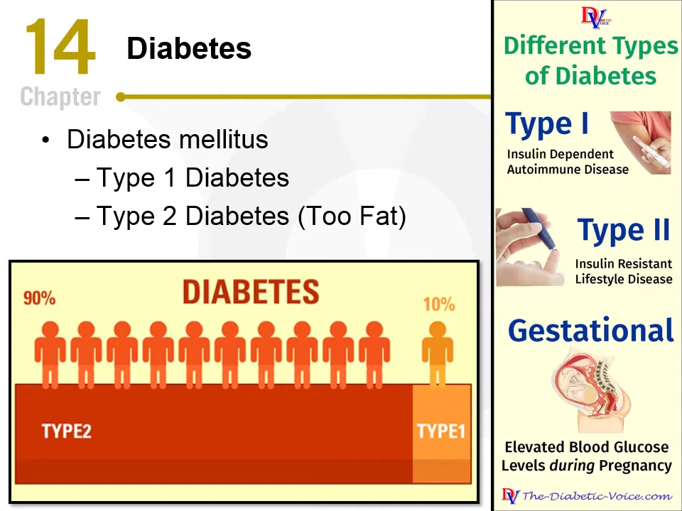

# スライド・ナレーション関係アノテーション（SNRA）マニュアル

## 目次

- [1. 本アノテーションの目的](#sec-1)
- [2. 本アノテーションの概要](#sec-2)
  - [2.1 表示される情報](#sec-2-1)
  - [2.2 作業内容の概要](#sec-2-2)
- [3. 作業内容の詳細](#sec-3)
  - [3.1 アノテーション作業の流れ](#sec-3-1)
  - [3.2 ラベルの種類と入力内容](#sec-3-2)
    - [3.2.1 スライド上の文字情報](#sec-3-2-1)
    - [3.2.2 図表・数式の説明](#sec-3-2-2)
    - [3.2.3 スライドに明示されない講義内容](#sec-3-2-3)
    - [3.2.4 メタ談話](#sec-3-2-4)
    - [3.2.5 無関係な内容](#sec-3-2-5)
    - [3.2.6 解釈不能な NU](#sec-3-2-6)
- [4. 作業例](#sec-4)

## 1. 本アノテーションの目的

講義で用いるスライドには、通常、内容が簡潔にまとめられている。講師はスライドの文章を読み上げたり言い換えたりするだけでなく、図表を説明し、理解に役立つ情報を補足し、講義の進行を管理する。また、現在のスライドとは関係のない内容を話すこともある。

本アノテーション作業は、講義の発話内容を対象に、スライドの内容との関係を明らかにすることを目的とする。作成したデータは、Implicit Lecture Content（ILC：現在のスライドに直接示されていないが、そのスライド上の話題の理解に役立つ情報）の分析と、理解に役立つ情報を補足する講義ナレーション生成の研究に利用する。

## 2. 本アノテーションの概要

### 2.1 表示される情報

講義の入力ファイルには、**スライド1枚ごとに**次の3項目が記載される。

1. 現在のスライド画像
2. そのスライドに対応付けられたナレーション（発話テキスト）の全文
3. そのナレーションから抽出された NU の一覧

**例：`example`（元講義の `slide_index: 11`）**

図 2.1：スライド画像の例

**対応するナレーション原文（冒頭と末尾。中間は「…」で省略）：**

> when it comes to diabetes most of us know there are two types type 1 type 2 … as i always like to do give you a little hints to help you remember things

**このナレーションから抽出された NU：**

1. `example_s011_u01` — When it comes to diabetes, most of us know there are two types: type 1, type 2.
2. `example_s011_u02` — The way I always remember type 2 is that you're too fat.
3. `example_s011_u03` — And it's more than just simply being too fat, but that's what we tend to talk about.

…

**NU（Narration Unit）** とは、スライド1枚分のナレーションを LLM で分割した発話単位である。NU の抽出には、次の方針を用いた。

- 1つの NU は、説明上の要点1つ、または談話行為（質問、話題の切り替えなど）1つを伝える、まとまりのある発話とする。
- 同じ要点について述べている部分は1つにまとめ、独立して理解できる別の要点・例・質問・談話行為に移った箇所で区切る。
- 講師の言い方と視点をできるだけ保ち、内容上の意味、限定、確信の度合い、意味のある強調を維持する。
- 句読点、言いよどみ、明らかな文字起こしの誤りは、情報を付け足さない範囲で軽く整える。

### 2.2 作業内容の概要

スライドとナレーションを参照し、NU 1件ごとにラベルを付ける。

**主ラベル一覧**

| 主ラベル | 概要 |
|---|---|
| `on_slide_content` | NU の内容がスライド上の文字で示されている。 |
| `figure_formula_explanation` | NU の内容がスライド上の図・表・数式・グラフ・画像から読み取れる。 |
| `implicit_lecture_content` | スライドに直接示されていない、話題の理解に役立つ情報を補足する。 |
| `metadiscourse` | 講義の進行、発言内容に対する講師の態度・評価、聞き手とのやり取りに関する発話。 |
| `unrelated_content` | 意味は分かるが、現在のスライドとの関係が上記のいずれにも当てはまらない（例：「今日は天気がいいですね」）。 |
| `invalid_nu` | 発話の途切れや、明らかな言い間違い・文字起こしの誤りなどにより、文脈を確認しても内容を理解できない NU。 |

1. NU ごとに、スライドとナレーションを参照して主ラベルを1つ選ぶ。
2. `implicit_lecture_content` を選んだ場合は、NU のうちスライドに書かれていない部分を `not_on_slide_span` に抜き出し、ILC分類を1つ `sublabel` に記入する。
3. `metadiscourse` を選んだ場合は、メタ談話の機能分類を1つ `sublabel` に記入する。
4. `sublabel` に `other` を選んだ場合は、必要と考えた分類とその理由を `note` に簡潔に記入する。

本マニュアルでは、`label` に記入する分類を「主ラベル」、`sublabel` に記入する分類を「サブラベル」、各サブラベルの説明に挙げた下位項目を「細分類」と呼ぶ。細分類は記入しない。

入力項目の一覧は 3.1、各ラベルの説明は 3.2 に示す。

## 3. 作業内容の詳細

### 3.1 アノテーション作業の流れ

各 NU の意味を確認した上で、**1から順に判断し、最初に当てはまった主ラベルを1つだけ選ぶ。** ラベルが決まったら、そのラベルに必要な追加入力を行い、次の NU に進む。

1. **スライド上の文字で内容が示されているか。** 示されていれば `on_slide_content`。
2. **図・表・数式・グラフ・画像で内容が示されているか。** 示されていれば `figure_formula_explanation`。
3. **スライド上の話題の理解に役立つ情報を補足しているか。** 補足していれば `implicit_lecture_content`。
4. **講義の構成・進行、講師の態度・評価、聞き手とのやり取りに関する発話か。** 該当すれば `metadiscourse`。
5. **以上のいずれにも当てはまらないか。** 意味が分かる NU であれば `unrelated_content`。

※ 発話が途中で切れている、明らかな言い間違いや文字起こしの誤りがあるなど、文脈を確認しても NU 自体の内容を理解できない場合に `invalid_nu` とする。画像が読めない、スライドとナレーションが対応していない、NU とナレーションの意味が異なるなど、判断の前提に問題がある場合は、`label` を空欄（`""`）のままにし、該当箇所と理由を `note` に記入して判断を保留する。

| 主ラベル | 追加入力 |
|---|---|
| `on_slide_content` | なし |
| `figure_formula_explanation` | なし |
| `implicit_lecture_content` | `not_on_slide_span`（NU からの抜き出し）＋ `sublabel`（ILC分類）1つ |
| `metadiscourse` | `sublabel`（機能分類）1つ |
| `unrelated_content` | なし |
| `invalid_nu` | なし |

### 3.2 ラベルの種類と入力内容

各 NU に、以下の主ラベルのいずれか1つを付ける。

#### 3.2.1 `on_slide_content` — スライド上の文字情報

NU の内容が、スライドのタイトル、箇条書き、説明文などの文字で示されている場合に選ぶ。意味を変えずに言い換えたものも含む。

#### 3.2.2 `figure_formula_explanation` — 図表・数式の説明

NU の内容が、スライドの図、表、数式、グラフ、画像などから読み取れる場合に選ぶ。

#### 3.2.3 `implicit_lecture_content` — スライドに明示されない講義内容

現在のスライドには直接示されていないが、**そのスライド上の話題の理解に役立つ情報を補足している**場合に選ぶ。

**追加入力：**

1. `not_on_slide_span`：NU のうち、スライドに書かれていないと判断した部分。NU の `text` から該当部分をそのままコピーする（言い換えや要約はしない）。
   - 該当部分が複数箇所に分かれている場合は、それらをすべて含む最短の連続した範囲をコピーする。
   - NU 全体がスライドに書かれていない内容であれば、NU 全体をコピーする。
2. `sublabel`：補足内容が果たしている役割に最も近い ILC分類を1つ。5つの分類のいずれにも当てはまらない場合は `other` を選び、必要と考えた分類とその理由を `note` に簡潔に記入する。

##### ILC分類一覧

以下に、ILC分類（サブラベル）5つと、それぞれに含まれる細分類を示す。

**ILC分類を1つ選んで `sublabel` に記入し、スライドに書かれていない部分を `not_on_slide_span` に抜き出す。** 細分類は判断の目安であり、記入は不要。

| 分類 | 定義 | 含まれる細分類 |
| --- | --- | --- |
| 概念の明確化 `concept_clarification` | 用語や概念の理解に役立つ情報を補足する。 | 定義・用語説明（Definition） 特徴・性質（Attribute） 詳述（Elaboration） 具体例・事例（Example） 類推・比喩（Analogy） 誤解の訂正（Misconception correction） |
| 説明・推論 `explanation_reasoning` | ある現象がなぜ・どのように生じるか、また結果が何を意味するかを説明する。 | 原因（Cause） 理由（Reason / Rationale） 仕組み（Mechanism） 過程（Process） 結果・影響（Result / Consequence） 含意（Implication） 解釈（Interpretation） |
| 背景・文脈知識 `contextual_knowledge` | 現在の話題の理解に役立つ外部知識や背景情報を補足する。 | 背景（Background） 歴史的経緯（Historical development） 証拠・裏付け（Evidence） 出典・提唱者（Source / Attribution） 応用・利用場面（Application / Use case） |
| 条件・関係・制約 `qualification_relation` | 主張や方法が成立する条件、前提、他の対象との関係、または制約を補足する。 | 条件（Condition） 仮定・前提（Assumption） 事前要件（Prerequisite） 比較（Comparison） 対照（Contrast） 制約・注意点（Limitation / Caveat） 例外（Exception） |
| 方法・実践 `method_action` | 方法を実施する手順や、問題を解決するための具体的な工夫を説明する。 | 方法・アプローチ（Method / Approach） 手順（Procedure / Step） 実践上の工夫（Practical strategy） |
| その他（`other`） | 既存の分類で補足内容や機能を表せない場合。 | 自由記述 |

##### 概念の明確化（Concept clarification） — `concept_clarification`

判断のポイント：用語や概念の意味・特徴について、聞き手が何を理解できるようになるかに注目する。定義、詳しい説明、具体的な事例によって概念を理解しやすくする補足が該当する。

| 細分類 | 詳しい説明 |
|---|---|
| 定義・用語説明（Definition） | 用語が何を意味するかを説明する。 |
| 特徴・性質（Attribute） | 概念や対象が持つ特徴を説明する。 |
| 詳述（Elaboration） | 簡潔な説明に、理解に必要な詳細を加える。 |
| 具体例・事例（Example） | 概念に当てはまる具体的な事例を示す。 |
| 類推・比喩（Analogy） | 身近なものにたとえて概念を説明する。 |
| 誤解の訂正（Misconception correction） | 概念について生じやすい誤解を正す。 |

##### 説明・推論（Explanation and reasoning） — `explanation_reasoning`

判断のポイント：NU が「なぜそうなるのか」「どのように生じるのか」「その結果から何が言えるのか」を説明しているかに注目する。原因、理由、仕組み、結果から導かれる意味などが該当する。結果を述べているだけの発話と、その理由や含意まで説明している発話を区別する。

| 細分類 | 詳しい説明 |
|---|---|
| 原因（Cause） | 現象や結果を生じさせる要因を示す。 |
| 理由（Reason / Rationale） | 主張、選択、結論が妥当とされる理由を示す。 |
| 仕組み（Mechanism） | 複数の要素がどのように働き合って結果が生じるかを説明する。 |
| 過程（Process） | 現象がどのような順序で進むかを説明する。 |
| 結果・影響（Result / Consequence） | ある出来事や行動によって生じる結果や影響を示す。 |
| 含意（Implication） | 事実や結果から、さらに何が言えるかを示す。 |
| 解釈（Interpretation） | 結果をどう捉えるか、その意味を説明する。 |

##### 背景・文脈知識（Contextual knowledge） — `contextual_knowledge`

判断のポイント：スライド上の話題を位置付けたり裏付けたりする周辺情報に注目する。歴史的な経緯、観察や研究で得られた事実、出典、使われる場面などが該当する。

| 細分類 | 詳しい説明 |
|---|---|
| 背景（Background） | 話題を理解するための周辺情報を示す。 |
| 歴史的経緯（Historical development） | 概念や方法が生まれた経緯、あるいは状況が変化してきた経緯を示す。 |
| 証拠・裏付け（Evidence） | 主張を裏付ける観察結果や研究上の知見を示す。 |
| 出典・提唱者（Source / Attribution） | 情報の出典や、考え方を提案した人物・組織を示す。 |
| 応用・利用場面（Application / Use case） | 概念や方法がどのような場面・目的で使われるかを示す。 |

##### 条件・関係・制約（Qualification and relation） — `qualification_relation`

判断のポイント：補足によって、主張や方法の適用範囲や他の対象との関係がどう明確になるかに注目する。成立する条件、説明の前提、他の対象との比較、利用上の制約、一般的な説明に対する例外などが該当する。

| 細分類 | 詳しい説明 |
|---|---|
| 条件（Condition） | 主張や方法が成立する条件を示す。 |
| 仮定・前提（Assumption） | 説明を進める上で、成り立つと仮定していることを示す。 |
| 事前要件（Prerequisite） | 実施や理解の前に満たしておく必要がある条件を示す。 |
| 比較（Comparison） | 共通の観点から複数の対象を比べる。 |
| 対照（Contrast） | 対象や方法の違いを際立たせる。 |
| 制約・注意点（Limitation / Caveat） | 解釈や利用に当たっての欠点や制限を示す。 |
| 例外（Exception） | 一般的な説明に当てはまらない事例を示す。 |

##### 方法・実践（Method and action） — `method_action`

判断のポイント：方法を実行したり問題を解決したりするために、何をするかに注目する。基本的な進め方、具体的な手順、状況に応じた工夫などが該当する。自然現象や認知の過程がどのように進むかを述べている場合は、「説明・推論」に当たるかを確認する。

| 細分類 | 詳しい説明 |
|---|---|
| 方法・アプローチ（Method / Approach） | 問題や目的に取り組む方法を示す。 |
| 手順（Procedure / Step） | 方法を実行する際の行動と順序を示す。 |
| 実践上の工夫（Practical strategy） | 状況に応じた対応や、作業をよりよく進めるための工夫を示す。 |

#### 3.2.4 `metadiscourse` — メタ談話

講義の構成や進行を示すこと、発言内容に対する講師の態度や評価を示すこと、または聞き手に働きかけることを主な目的とする発話に選ぶ。

**追加入力：**`sublabel` に機能分類を1つ記入する。

##### メタ談話の機能分類一覧

以下に、メタ談話の機能分類（サブラベル）3つと、それぞれに含まれる細分類を示す。右端の列で各細分類を説明している。`sublabel` に記入するのは機能分類1つであり、細分類は記入しない。

| 分類 | 定義 | 含まれる細分類 | 詳しい説明 |
|---|---|---|---|
| 談話の構成・進行 `organization_management` | 講義・発表の構成や順序を示し、話題の切り替えや進行を案内する。 | 導入・開始（Opening） 終了（Closing） 話題の導入（Topic introduction） 目的の提示（Goal announcement） 順序・列挙（Sequencing） 移行・話題転換（Transition） 予告（Previewing） 振り返り（Reviewing） 要約（Summarizing） 話題の終了（Concluding） 講義内の他の箇所への言及（Endophoric reference） 余談の明示（Aside） 本題への復帰（Returning to topic） 課題・日程管理（Task / Schedule management） 時間管理（Time management） | 導入・開始：講義・発表の開始を示す。 終了：講義・発表全体の終了を示す。 話題の導入：これから扱う話題を示す。 目的の提示：講義や各節の目的を示す。 順序・列挙：説明する順序を示す。 移行・話題転換：説明する項目や節の切り替えを示す。 予告：後で扱う内容を予告する。 振り返り：すでに扱った内容を振り返る。 要約：説明の要点をまとめる段階であることを示す。 話題の終了：1つの話題や節を締めくくる。 講義内の他の箇所への言及：講義や資料の、すでに扱った箇所やこれから扱う箇所に言及する。 余談の明示：本題から一時的に離れることを示す。 本題への復帰：本題に戻ることを示す。 課題・日程管理：課題や日程に関する連絡を行う。 時間管理：残り時間や時間配分に応じて進行を調整する。 |
| 話者のスタンス `speaker_stance` | 発言内容について、話者がどの程度確信しているか、どのような態度や評価を示しているか、どこまで言い切るかを示す。 | 婉曲・不確実性（Hedge / Uncertainty） 強調・確信（Booster / Certainty） 態度・評価（Attitude / Evaluation） 重要性の提示（Importance marking） 難易度の提示（Difficulty marking） 話者自身の立場（Self-positioning） 断言する範囲の限定（Limiting commitment） | 婉曲・不確実性：確信の程度を控えめに示す。 強調・確信：強い確信を示したり、主張を強調したりする。 態度・評価：内容に対する態度や評価を示す。 重要性の提示：説明上重要な点であることを示す。 難易度の提示：内容の理解のしやすさや難しさを示す。 話者自身の立場：話者がどの立場から発言しているかを示す。 断言する範囲の限定：話者がどこまで言い切れるか、その範囲を示す。 |
| 聞き手への働きかけ `audience_interaction` | 聞き手に直接働きかけ、注意を向けさせたり、理解を確認したり、参加を促したりする。 | 直接的な呼びかけ（Direct address） 注目の誘導（Attention directing） 理解確認（Comprehension check） 音声・表示の確認（Channel check） 質問・参加の促進（Question / Invitation） 指示・依頼（Directive / Request） 共有知識への言及（Shared knowledge） 聞き手の反応の先取り（Anticipating response） 聞き手を含めた表現（Inclusive reference） 質疑応答の管理（Q&A management） 挨拶・謝辞（Greeting / Thanks） | 直接的な呼びかけ：聞き手に直接呼びかける。 注目の誘導：特定の説明や資料の箇所に聞き手の注意を向ける。 理解確認：聞き手が理解できているかを確認する。 音声・表示の確認：音声が聞こえるか、資料が見えるかを確認する。 質問・参加の促進：質問や参加の呼びかけによって反応を促す。 指示・依頼：聞き手に行動を求める。 共有知識への言及：聞き手と共有している知識に言及する。 聞き手の反応の先取り：聞き手が抱きそうな疑問や反応にあらかじめ触れる。 聞き手を含めた表現：「私たち」など、聞き手を含めた表現で参加を促す。 質疑応答の管理：質問を受け付けるなど、質疑応答を進める。 挨拶・謝辞：聞き手への挨拶や謝意を示す。 |
| その他（`other`） | 発話の機能を既存の分類で表せない場合。 | 自由記述 | 必要と考えた分類とその理由を `note` に簡潔に記入する。 |

#### 3.2.5 `unrelated_content` — 無関係な内容

意味が分かる NU のうち、現在のスライドに直接示される内容、話題の理解に役立つ補足、メタ談話のいずれにも当てはまらない場合に選ぶ。

**追加入力：**なし。

#### 3.2.6 `invalid_nu` — 解釈不能な NU

発話が途中で途切れている、明らかな言い間違いや文字起こしの誤りによって意味が通らないなど、前後のナレーションやスライドを確認しても NU 自体が何を述べているか理解できない場合に選ぶ。指示語の指示対象は文脈から補い、指示語があるというだけではこのラベルを選ばない。

**追加入力：**なし。

## 4. 作業例

`lectures/example.json` のスライド（`slide_index: 11`）と、`results/example.json` のアノテーション結果を示す。

**スライド画像**

**ナレーション原文（全文）**

> when it comes to diabetes most of us know there are two types type 1 type 2 the way i always remember type 2 is that you're too fat and it's more than just simply being too fat but that's what we tend to talk about and as you can see in the chart there's a lot more type 2 diabetes than there is type 1 now there is a third type of diabetes which is basically women who are pregnant who get elevated glucose levels during pregnancy but for most of us we tend to you've only type 1 and type 2 those of you who are going into the allied health fields you'll might even discuss up to five different types of diabetes but for us for this class type 1 type 2 and remember type 2 is because you're too fat as i always like to do give you a little hints to help you remember things

**NU とアノテーション結果（全9件）**

| NU ID | NU（全文） | `label` | 追加入力 |
|---|---|---|---|
| `example_s011_u01` | When it comes to diabetes, most of us know there are two types: type 1, type 2. | `on_slide_content` | なし |
| `example_s011_u02` | The way I always remember type 2 is that you're too fat. | `on_slide_content` | なし |
| `example_s011_u03` | And it's more than just simply being too fat, but that's what we tend to talk about. | `implicit_lecture_content` | `sublabel`: `concept_clarification` `not_on_slide_span`: `more than just simply being too fat` |
| `example_s011_u04` | As you can see in the chart, there's a lot more type 2 diabetes than there is type 1. | `figure_formula_explanation` | なし |
| `example_s011_u05` | Now, there is a third type of diabetes, which is basically women who are pregnant who get elevated glucose levels during pregnancy. | `on_slide_content` | なし |
| `example_s011_u06` | But for most of us, we tend to you've only type 1 and type 2. | `metadiscourse` | `sublabel`: `audience_interaction` |
| `example_s011_u07` | Those of you who are going into the allied health fields, you'll might even discuss up to five different types of diabetes. | `implicit_lecture_content` | `sublabel`: `contextual_knowledge` `not_on_slide_span`: `allied health fields, you'll might even discuss up to five different types of diabetes` |
| `example_s011_u08` | But for us, for this class, type 1, type 2, and remember type 2 is because you're too fat. | `metadiscourse` | `sublabel`: `organization_management` |
| `example_s011_u09` | As I always like to do, give you a little hints to help you remember things. | `metadiscourse` | `sublabel`: `speaker_stance` |

`example_s011_u03` では、スライドに「Too Fat」とは書かれているが、「単に太りすぎというだけではない」という点は書かれていないため、その部分を抜き出している。
`example_s011_u07` では、スライドには3種類の糖尿病しか示されておらず、「医療系の分野では最大5種類を扱う」という点は書かれていない。「allied health fields」と「five different types」が離れているため、両方を含む最短の範囲を抜き出している。
