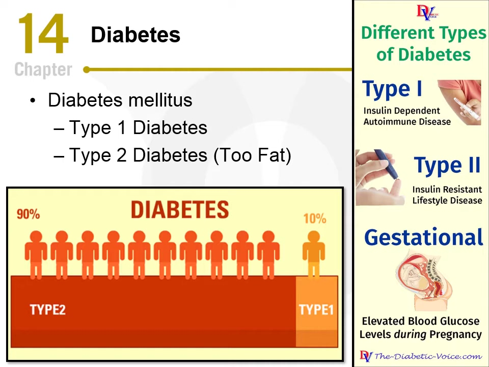
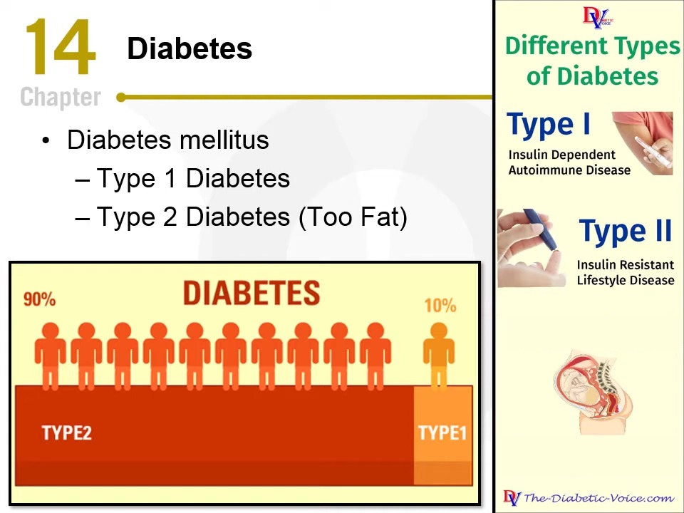
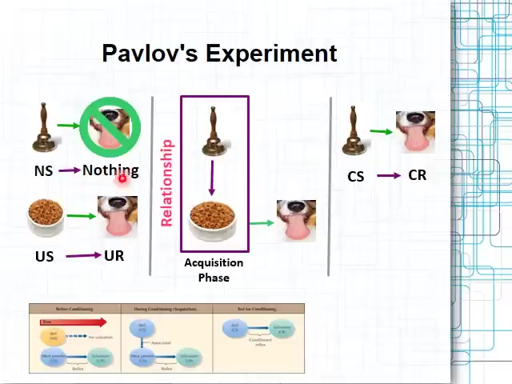

# スライド・ナレーション関係アノテーション（SNRA）マニュアル

## 目次

- [1. 本アノテーションの目的](#sec-1)
- [2. 作業の進め方](#sec-2)
  - [2.1 参照する情報](#sec-2-1)
  - [2.2 作業の手順](#sec-2-2)
  - [2.3 判断できない場合](#sec-2-3)
- [3. ラベルの定義と判断基準](#sec-3)
  - [3.1 on_slide_textual_content / on_slide_visual_content](#sec-3-1)
  - [3.2 implicit_lecture_content](#sec-3-2)
  - [3.3 metadiscourse](#sec-3-3)
  - [3.4 unrelated_content](#sec-3-4)
  - [3.5 invalid_nu](#sec-3-5)
  - [3.6 判断に迷うケース](#sec-3-6)
- [4. 作業例](#sec-4)
  - [4.1 スライド1枚分の作業例](#sec-4-1)
  - [4.2 on_slide_visual_content と implicit_lecture_content が混在する NU](#sec-4-2)

## 1. 本アノテーションの目的

講義で用いるスライドには、通常、内容が簡潔にまとめられている。話者はスライドの文章を読み上げたり言い換えたりするだけでなく、図表を説明し、話題の理解に役立つ情報を補足し、講義の進行を管理する。また、スライドとは関係のない内容を話すこともある。

本アノテーションは、講義の発話とスライドに示された内容との関係を明らかにすることを目的とする。作成したデータは、Implicit Lecture Content（ILC：**現在の**スライドに直接示されていないが、そのスライド上の話題の理解に役立つ情報）の分析と、理解に役立つ情報を補足する講義ナレーション生成の研究に利用する。

## 2. 作業の進め方

### 2.1 参照する情報

次の情報が提供される。

<table width="100%"><tr><td>
<ol>
<li>講義動画</li>
<li>現在のスライドの画像</li>
<li>そのスライドが表示されている間のナレーション（話者の発話の文字起こし）</li>
<li>Narration Unit の一覧</li>
</ol>
</td></tr></table>

Narration Unit（以下、NU）は、ナレーションを、説明の要点や談話行為（質問、話題の切り替えなど）ごとに区切った発話の単位であり、本アノテーションでラベルを付ける単位である。

**例：**

<table width="100%">
<tr>
<td width="50%" valign="top"></td>
<td width="50%" valign="top"><b>ナレーション全文</b>  
when it comes to diabetes most of us know there are two types type 1 type 2 the way i always remember type 2 is that you're too fat and it's more than just simply being too fat but that's what we tend to talk about and as you can see in the chart there's a lot more type 2 diabetes than there is type 1 now there is a third type of diabetes which is basically women who are pregnant who get elevated glucose levels during pregnancy but for most of us we tend to think of only type 1 and type 2 those of you who are going into the allied health fields you'll might even discuss up to five different types of diabetes but for us for this class type 1 type 2 and remember type 2 is because you're too fat as i always like to do give you a little hints to help you remember things  
<b>NU 一覧</b>（NU ごとに主ラベルを1つ選ぶ）  
u01：When it comes to diabetes, most of us know there are two types: type 1, type 2. 
<kbd>on_slide_textual_content</kbd> <kbd>on_slide_visual_content&nbsp;</kbd> 
<kbd>implicit_lecture_content</kbd> <kbd>&nbsp;&nbsp;&nbsp;&nbsp;&nbsp;metadiscourse&nbsp;&nbsp;&nbsp;&nbsp;&nbsp;&nbsp;</kbd> 
<kbd>&nbsp;&nbsp;&nbsp;unrelated_content&nbsp;&nbsp;&nbsp;&nbsp;</kbd> <kbd>&nbsp;&nbsp;&nbsp;&nbsp;&nbsp;&nbsp;&nbsp;invalid_nu&nbsp;&nbsp;&nbsp;&nbsp;&nbsp;&nbsp;&nbsp;</kbd>  
u02：The way I always remember type 2 is that you're too fat. 
<kbd>on_slide_textual_content</kbd> <kbd>on_slide_visual_content&nbsp;</kbd> 
<kbd>implicit_lecture_content</kbd> <kbd>&nbsp;&nbsp;&nbsp;&nbsp;&nbsp;metadiscourse&nbsp;&nbsp;&nbsp;&nbsp;&nbsp;&nbsp;</kbd> 
<kbd>&nbsp;&nbsp;&nbsp;unrelated_content&nbsp;&nbsp;&nbsp;&nbsp;</kbd> <kbd>&nbsp;&nbsp;&nbsp;&nbsp;&nbsp;&nbsp;&nbsp;invalid_nu&nbsp;&nbsp;&nbsp;&nbsp;&nbsp;&nbsp;&nbsp;</kbd>  
u03：And it's more than just simply being too fat, but that's what we tend to talk about. 
<kbd>on_slide_textual_content</kbd> <kbd>on_slide_visual_content&nbsp;</kbd> 
<kbd>implicit_lecture_content</kbd> <kbd>&nbsp;&nbsp;&nbsp;&nbsp;&nbsp;metadiscourse&nbsp;&nbsp;&nbsp;&nbsp;&nbsp;&nbsp;</kbd> 
<kbd>&nbsp;&nbsp;&nbsp;unrelated_content&nbsp;&nbsp;&nbsp;&nbsp;</kbd> <kbd>&nbsp;&nbsp;&nbsp;&nbsp;&nbsp;&nbsp;&nbsp;invalid_nu&nbsp;&nbsp;&nbsp;&nbsp;&nbsp;&nbsp;&nbsp;</kbd>  
…
</td>
</tr>
</table>

### 2.2 作業の手順

スライド1枚ごとに、次の手順で作業する。

<table width="100%"><tr><td>
<ol>
<li>講義動画を視聴しながら、スライド画像、ナレーション、NU を確認し、スライドの内容と各 NU の内容を十分に理解する。</li>
<li>NU ごとに、主な目的や主旨に最も近い主ラベル（<code>label</code>）を1つ選ぶ。主ラベルによっては、追加入力を行う（<a href="#sec-3">第3章</a>）。</li>
<li>判断できない場合は、<a href="#sec-2-3">2.3</a> に従う。</li>
</ol>
</td></tr></table>

### 2.3 判断できない場合

- スライド画像が不鮮明・不完全で、NU とスライドの関係の判断に影響する場合は、`label` を空欄（`""`）のままにし、`note` に該当箇所と理由を記入する。判断に影響しない場合は、通常どおりラベルを付ける。
- スライド、ナレーション、講義動画を確認しても NU の内容を理解できない場合は、`invalid_nu` とし、`note` に理由を記入する（[3.5](#sec-3-5)）。

## 3. ラベルの定義と判断基準

主ラベルは、次の原則に従って選ぶ。

1. NU の主な目的や主旨（話者がなぜその発話をしているのか、何を主に伝えようとしているのか）に最も近い主ラベルを1つ選ぶ。
2. スライドとの関係は、現在のスライドのみを基準として判断する。
3. 本研究は ILC（現在のスライドに直接示されていないが、そのスライド上の話題の理解に役立つ情報）の分析を主な目的としているため、`implicit_lecture_content` はほかの主ラベルより優先する。NU の一部にでもスライドに示されていない補足が含まれる場合は、主ラベルを `implicit_lecture_content` とする。

### 3.1 on_slide_textual_content / on_slide_visual_content

#### 3.1.1 定義

NU の主旨が、スライドに示された内容を聞き手に説明すること（講義の話題に関する知識を伝えること）にある場合に選ぶ。意味を変えずに言い換えたものや、すでに説明した内容を言い直したものも含む。

- `on_slide_textual_content`：スライドに示された文字を読めば理解できる内容を説明する。
- `on_slide_visual_content`：図の構造や画像の内容を見て理解する必要がある内容を説明する。

#### 3.1.2 判断の目安

- NU の内容が、スライドにおおむね示されている。
- 直前の NU や、すでに説明した内容を言い直している場合も、その内容がスライドにおおむね示されていれば、このラベルとする。

#### 3.1.3 on_slide_textual_content と on_slide_visual_content の区別

2つのラベルは、**NU の内容を理解するのに、視覚的な理解が必要かどうか**で区別する。スライドの要素ごとの扱いの目安を、次に示す。

| 要素 | 扱い |
|---|---|
| タイトル、箇条書き、文章、数式（手書きを含む） | `on_slide_textual_content` |
| 表 | 文字と数値で構成される標準的な表は `on_slide_textual_content`。画像の理解が必要な表は `on_slide_visual_content` |
| 図、フローチャート、グラフ、画像など | 伝えている情報の中心が文字で、文字を読めば理解できる場合は `on_slide_textual_content`。図の構造や画像の理解が必要な場合は `on_slide_visual_content` |

1つの NU が複数の要素に触れている場合は、NU が主に説明している要素に応じて選ぶ。同じ NU でも、スライドに文字で示されているか、画像のみで示されているかによって判断が変わる例は、[4.1 の u05](#ex-4-1-u05) を参照。

### 3.2 implicit_lecture_content

#### 3.2.1 定義

現在のスライドには示されていないが、**そのスライド上の話題の理解に役立つ情報を補足している**場合に選ぶ。NU の一部のみが補足である場合も、このラベルを選ぶ（[第3章](#sec-3) 冒頭の原則3）。NU のうち、補足に当たる部分を「補足部分」、それ以外の部分を「残りの部分」と呼ぶ。

前のスライドに示されている内容であっても、現在のスライドに示されていなければ補足とする。前のスライドを参照する必要はない。

#### 3.2.2 判断の目安

- スライドに示されていない内容（具体例、理由、条件、背景、方法など）を加えている。
- その内容が、話題の理解に役立つ。削除すると失われる内容であっても、話題の理解に役立つ情報でなければ（例：話者が自分の発言に対する態度を示している）、補足としない。

#### 3.2.3 追加入力

1. `sublabel`（サブラベル）：補足部分が果たしている役割に最も近いサブラベルを、[3.2.4 サブラベル一覧](#sec-3-2-4) から1つ選ぶ。補足部分が複数のサブラベルにまたがる場合は、NU の主な目的や主旨に最も近いものを1つ選ぶ。いずれにも当てはまらない場合は `other` を選び、必要と考えたサブラベルとその理由を `note` に簡潔に記入する。
2. `not_on_slide_span`（補足部分）：NU の text から、補足部分をそのままコピーする。
   - 補足部分の範囲は、**その部分を削除すると、聞き手が受け取る内容が失われるか**で判断する。具体例、説明、限定、背景など、内容面の情報が失われる部分を含め、言い換え、繰り返し、言いよどみなど、言い回しが変わるにすぎない部分は含めない。
   - 可能な限り短い句・節の単位で抜き出す。冠詞やカンマ、ピリオドなど、補足部分に付属する要素は含めてよい（厳密さは求めない）。
   - 補足部分が複数箇所に分かれている場合は、それらをすべて含む最短の連続した範囲をコピーする。
   - NU 全体が補足であれば、NU 全体をコピーする。
3. `remainder_label`（残りの部分の主ラベル）：補足部分を除いても、残りの部分のみで意味の通る文や句になっている場合に、その部分に当てはまる主ラベルを `on_slide_textual_content`、`on_slide_visual_content`、`metadiscourse`、`unrelated_content` の4つから1つ選んで記入する。次の場合は空欄（`""`）とする。
   - NU 全体が補足である場合
   - 残りの部分に主ラベルを付けられない場合

#### 3.2.4 サブラベル一覧

サブラベルは、補足部分が果たしている役割で選ぶ。細分類はサブラベルを選ぶ際の目安であり、記入しない。

<table>
<tr><th width="34%">サブラベル</th><th width="22%">細分類</th><th width="44%">細分類の説明</th></tr>
<tr><td rowspan="4"><b>概念の明確化</b> <code>concept_clarification</code>  用語や概念の理解に役立つ情報を補足する。  <b>判断のポイント：</b>用語や概念の意味・特徴について、聞き手が何を理解できるようになるかに注目する。定義や詳しい説明によって概念を理解しやすくする補足が該当する。具体的な事例を挙げている場合は <code>example</code> とする。</td><td>定義・用語説明（Definition）</td><td>用語が何を意味するかを説明する。</td></tr>
<tr><td>特徴・性質（Attribute）</td><td>概念や対象が持つ特徴を説明する。</td></tr>
<tr><td>詳述（Elaboration）</td><td>簡潔な説明に、理解に必要な詳細を加える。</td></tr>
<tr><td>誤解の訂正（Misconception correction）</td><td>概念について生じやすい誤解を正す。</td></tr>
<tr><td rowspan="2"><b>具体例</b> <code>example</code>  スライドの内容に当てはまる具体的な事例を示す。  <b>判断のポイント：</b>特定の人物、場面、出来事などを挙げて、スライドの内容を具体的に示しているかに注目する。1つの事例が複数の NU にわたる場合や、事例を挙げた後で「これが〇〇に当たる」と概念に結び付けている部分も、このサブラベルとする。</td><td>具体例・事例（Example）</td><td>概念に当てはまる具体的な事例を示す。当てはまらない事例（反例）も含む。</td></tr>
<tr><td>類推・比喩（Analogy）</td><td>身近なものにたとえて概念を説明する。</td></tr>
<tr><td rowspan="7"><b>説明・推論</b> <code>explanation_reasoning</code>  ある現象がなぜ・どのように生じるか、また結果が何を意味するかを説明する。  <b>判断のポイント：</b>「なぜそうなるのか」「どのように生じるのか」「その結果から何が言えるのか」を説明しているかに注目する。結果を述べているだけの発話と、その理由や含意まで説明している発話を区別する。</td><td>原因（Cause）</td><td>現象や結果を生じさせる要因を示す。</td></tr>
<tr><td>理由（Reason / Rationale）</td><td>主張、選択、結論が妥当とされる理由を示す。</td></tr>
<tr><td>仕組み（Mechanism）</td><td>複数の要素がどのように働き合って結果が生じるかを説明する。</td></tr>
<tr><td>過程（Process）</td><td>現象がどのような順序で進むかを説明する。</td></tr>
<tr><td>結果・影響（Result / Consequence）</td><td>ある出来事や行動によって生じる結果や影響を示す。</td></tr>
<tr><td>含意（Implication）</td><td>事実や結果から、さらに何が言えるかを示す。</td></tr>
<tr><td>解釈（Interpretation）</td><td>結果をどう捉えるか、その意味を説明する。</td></tr>
<tr><td rowspan="5"><b>背景・文脈知識</b> <code>contextual_knowledge</code>  現在の話題の理解に役立つ外部知識や背景情報を補足する。  <b>判断のポイント：</b>スライド上の話題を位置付けたり裏付けたりする周辺情報に注目する。歴史的な経緯、観察や研究で得られた事実、出典、使われる場面などが該当する。</td><td>背景（Background）</td><td>話題を理解するための周辺情報を示す。</td></tr>
<tr><td>歴史的経緯（Historical development）</td><td>概念や方法が生まれた経緯、あるいは状況が変化してきた経緯を示す。</td></tr>
<tr><td>証拠・裏付け（Evidence）</td><td>主張を裏付ける観察結果や研究上の知見を示す。</td></tr>
<tr><td>出典・提唱者（Source / Attribution）</td><td>情報の出典や、考え方を提案した人物・組織を示す。</td></tr>
<tr><td>応用・利用場面（Application / Use case）</td><td>概念や方法がどのような場面・目的で使われるかを示す。</td></tr>
<tr><td rowspan="6"><b>条件・関係・制約</b> <code>qualification_relation</code>  主張や方法が成立する条件、前提、他の対象との関係、または制約を補足する。  <b>判断のポイント：</b>補足によって、主張や方法の適用範囲や他の対象との関係がどう明確になるかに注目する。</td><td>条件（Condition）</td><td>主張や方法が成立する条件を示す。</td></tr>
<tr><td>仮定・前提（Assumption）</td><td>説明を進めるうえで、成り立つと仮定していることを示す。</td></tr>
<tr><td>事前要件（Prerequisite）</td><td>実施や理解の前に満たしておく必要がある条件を示す。</td></tr>
<tr><td>比較（Comparison）</td><td>共通の観点から複数の対象を比べる。</td></tr>
<tr><td>対照（Contrast）</td><td>対象や方法の違いを際立たせる。</td></tr>
<tr><td>制約・注意点（Limitation / Caveat）</td><td>解釈や利用に当たっての欠点や制限を示す。</td></tr>
<tr><td rowspan="3"><b>方法・実践</b> <code>method_action</code>  方法を実施する手順や、問題を解決するための具体的な工夫を説明する。  <b>判断のポイント：</b>方法を実行したり問題を解決したりするために、何をするかに注目する。自然現象や認知の過程がどのように進むかを述べている場合は、「説明・推論」に当たるかを確認する。</td><td>方法・アプローチ（Method / Approach）</td><td>問題や目的に取り組む方法を示す。</td></tr>
<tr><td>手順（Procedure / Step）</td><td>方法を実行する際の行動と順序を示す。</td></tr>
<tr><td>実践上の工夫（Practical strategy）</td><td>状況に応じた対応や、作業をよりよく進めるための工夫を示す。</td></tr>
<tr><td><b>既出内容の再提示</b> <code>prior_content_recall</code>  講義の中ですでに説明された内容を、改めて述べる補足。  <b>判断のポイント：</b>現在のスライドと NU の表現から、すでに説明された内容を改めて述べていると判断できる場合に選ぶ。前のスライドを参照する必要はない。</td><td>（細分類なし）</td><td>手がかりの例：スライドが手順の途中（「Step #3」など）から始まっている、NU に "once you have ~"、"as I mentioned" などの表現がある。手がかりがなく判断できない場合は、内容に応じてほかのサブラベルを選ぶ。</td></tr>
<tr><td><b>その他</b> <code>other</code>  既存のサブラベルで補足部分の役割を表せない場合。</td><td>自由記述</td><td>必要と考えたサブラベルとその理由を <code>note</code> に簡潔に記入する。</td></tr>
</table>

### 3.3 metadiscourse

#### 3.3.1 定義

講義の構成や進行を示すこと、発言内容に対する話者の態度や評価を示すこと、または聞き手に働きかけることを主な目的とする発話に選ぶ。講義の話題に関する知識は伝えない。

#### 3.3.2 判断の目安

- これから扱う話題を導入したり、説明の区切りや話題の転換を示したりしている。
- 「ここまでの要点をまとめます」のように、説明の要点をまとめる段階であることを明示している。
- スライドに示された参考資料（動画、URL など）を見るよう案内している。
- 話者が、発言内容に対する確信、態度、評価、自分の立場などを示している。
- 聞き手と共有している認識に触れたり、聞き手の理解を確認したりしている。

#### 3.3.3 追加入力

`sublabel`（サブラベル）：NU の主な目的や主旨に最も近いサブラベルを、[3.3.4 サブラベル一覧](#sec-3-3-4) から1つ選ぶ。いずれにも当てはまらない場合は `other` を選び、必要と考えたサブラベルとその理由を `note` に簡潔に記入する。

#### 3.3.4 サブラベル一覧

細分類はサブラベルを選ぶ際の目安であり、記入しない。

<table>
<tr><th width="28%">サブラベル</th><th width="24%">細分類</th><th width="48%">細分類の説明</th></tr>
<tr><td rowspan="15"><b>談話の構成・進行</b> <code>organization_management</code>  講義・発表の構成や順序を示し、話題の切り替えや進行を案内する。</td><td>導入・開始（Opening）</td><td>講義・発表の開始を示す。</td></tr>
<tr><td>終了（Closing）</td><td>講義・発表全体の終了を示す。</td></tr>
<tr><td>話題の導入（Topic introduction）</td><td>これから扱う話題を示す。</td></tr>
<tr><td>目的の提示（Goal announcement）</td><td>講義や各節の目的を示す。</td></tr>
<tr><td>順序・列挙（Sequencing）</td><td>説明する順序を示す。</td></tr>
<tr><td>移行・話題転換（Transition）</td><td>説明する項目や節の切り替えを示す。</td></tr>
<tr><td>予告（Previewing）</td><td>後で扱う内容を予告する。</td></tr>
<tr><td>振り返り（Reviewing）</td><td>すでに扱った内容を振り返る。</td></tr>
<tr><td>要約（Summarizing）</td><td>説明の要点をまとめる段階であることを示す。</td></tr>
<tr><td>話題の終了（Concluding）</td><td>1つの話題や節を締めくくる。</td></tr>
<tr><td>講義内の他の箇所への言及（Endophoric reference）</td><td>講義や資料の、すでに扱った箇所やこれから扱う箇所に言及する。</td></tr>
<tr><td>余談の明示（Aside）</td><td>本題から一時的に離れることを示す。</td></tr>
<tr><td>本題への復帰（Returning to topic）</td><td>本題に戻ることを示す。</td></tr>
<tr><td>課題・日程管理（Task / Schedule management）</td><td>課題や日程に関する連絡を行う。</td></tr>
<tr><td>時間管理（Time management）</td><td>残り時間や時間配分に応じて進行を調整する。</td></tr>
<tr><td rowspan="7"><b>話者のスタンス</b> <code>speaker_stance</code>  発言内容について、話者がどの程度確信しているか、どのような態度や評価を示しているか、どこまで言い切るかを示す。</td><td>婉曲・不確実性（Hedge / Uncertainty）</td><td>確信の程度を控えめに示す。</td></tr>
<tr><td>強調・確信（Booster / Certainty）</td><td>強い確信を示したり、主張を強調したりする。</td></tr>
<tr><td>態度・評価（Attitude / Evaluation）</td><td>内容に対する態度や評価を示す。</td></tr>
<tr><td>重要性の提示（Importance marking）</td><td>説明上重要な点であることを示す。</td></tr>
<tr><td>難易度の提示（Difficulty marking）</td><td>内容の理解のしやすさや難しさを示す。</td></tr>
<tr><td>話者自身の立場（Self-positioning）</td><td>話者がどの立場から発言しているかを示す。</td></tr>
<tr><td>断言する範囲の限定（Limiting commitment）</td><td>話者がどこまで言い切れるか、その範囲を示す。</td></tr>
<tr><td rowspan="11"><b>聞き手への働きかけ</b> <code>audience_interaction</code>  聞き手に直接働きかけ、注意を向けさせたり、理解を確認したり、参加を促したりする。</td><td>直接的な呼びかけ（Direct address）</td><td>聞き手に直接呼びかける。</td></tr>
<tr><td>注目の誘導（Attention directing）</td><td>特定の説明や資料の箇所に聞き手の注意を向ける。</td></tr>
<tr><td>理解確認（Comprehension check）</td><td>聞き手が理解できているかを確認する。</td></tr>
<tr><td>音声・表示の確認（Channel check）</td><td>音声が聞こえるか、資料が見えるかを確認する。</td></tr>
<tr><td>質問・参加の促進（Question / Invitation）</td><td>質問や参加の呼びかけによって反応を促す。</td></tr>
<tr><td>指示・依頼（Directive / Request）</td><td>聞き手に行動を求める。</td></tr>
<tr><td>共有知識への言及（Shared knowledge）</td><td>聞き手と共有している知識に言及する。</td></tr>
<tr><td>聞き手の反応の先取り（Anticipating response）</td><td>聞き手が抱きそうな疑問や反応にあらかじめ触れる。</td></tr>
<tr><td>聞き手を含めた表現（Inclusive reference）</td><td>「私たち」など、聞き手を含めた表現で参加を促す。</td></tr>
<tr><td>質疑応答の管理（Q&amp;A management）</td><td>質問を受け付けるなど、質疑応答を進める。</td></tr>
<tr><td>挨拶・謝辞（Greeting / Thanks）</td><td>聞き手への挨拶や謝意を示す。</td></tr>
<tr><td><b>その他</b> <code>other</code>  発話の機能を既存のサブラベルで表せない場合。</td><td>自由記述</td><td>必要と考えたサブラベルとその理由を <code>note</code> に簡潔に記入する。</td></tr>
</table>

### 3.4 unrelated_content

**定義**

意味が分かる NU のうち、聞き手に講義の話題に関する知識を伝えず、`metadiscourse` にも当たらない場合に選ぶ（例：「今日は天気がいいですね」）。

**追加入力**：なし。

### 3.5 invalid_nu

**定義**

スライド、ナレーション、講義動画を確認しても、NU が何を述べているか理解できない場合に選ぶ（例：発話が途中で途切れていて、意味が通らない）。

**追加入力**：`note` に、理解できない理由を簡潔に記入する。

### 3.6 判断に迷うケース

#### 3.6.1 主ラベルの判断に迷うケース

- **1つの NU に、複数の主ラベルに当たる内容が含まれる場合**
  - スライドに示されていない補足が含まれる場合は、[第3章](#sec-3) 冒頭の原則3のとおり、主ラベルを `implicit_lecture_content` とし、残りの部分の主ラベルを `remainder_label` に記入する（例：[4.1 の u03](#ex-4-1-u03)、[4.2 の u02](#ex-4-2-u02)）。
  - 補足が含まれない場合（例：スライドに示された内容と、話の導入や話者の態度を示す表現が含まれる場合）は、NU の主な目的や主旨に最も近い主ラベルを1つ選ぶ（例：[4.1 の u01](#ex-4-1-u01)）。
- **NU 中の語はスライドにあるが、話題を導入しているだけの場合**
  - 判断：`metadiscourse` の `organization_management`（細分類：話題の導入）
  - 例：Next, let's talk about diabetes.
  - 理由：スライドに示された語を含むが、その語を次の話題として導入しているだけで、講義の話題に関する知識は伝えていない。
- **説明の区切りや話題の転換を明確に示している場合**
  - 判断：`metadiscourse` の `organization_management`（細分類：移行・話題転換）
  - 例：「このスライドではXXXについて説明しました。次はYYYについて話します」
  - 理由：XXX がスライドに示されていても、`on_slide_textual_content` や `on_slide_visual_content` とはしない。発話の主旨は、説明の区切りや話題の転換を示すことにあるため、`metadiscourse` とする。
- **ほかの話をはさんだ後で、すでに説明した内容を改めて述べている場合**
  - 判断：内容がスライドにおおむね示されていれば `on_slide_textual_content`
  - 例：[4.1 の u08](#ex-4-1-u08)
  - 理由：冒頭の "But for us, for this class," のような表現のみでは、説明の区切りや話題の転換を明確に示しているとはいえない。
- **参考資料を見るよう案内している場合**
  - 判断：`metadiscourse` の `audience_interaction`（細分類：注目の誘導）
  - 例：If you want to know more about diabetes, check the URL below.（スライドの下部にリンクが示されている）
  - 理由：NU はスライドに示されたリンクについて述べているが、講義の話題に関する知識は伝えていないため、`metadiscourse` とする。
- **「前に説明したように」のように、すでに説明した内容に触れている場合**
  - 判断：説明した内容そのものを述べていない場合は、`metadiscourse` の `organization_management`（細分類：振り返り）。説明した内容そのものを改めて述べており、その内容が現在のスライドに示されていない場合は、`implicit_lecture_content` の `prior_content_recall`（[3.6.2](#sec-3-6-2)）。
- **画像に関連するが、画像だけでは内容がカバーされない場合**
  - 判断：`implicit_lecture_content`。図や画像の説明に当たる部分は、`remainder_label` を `on_slide_visual_content` とする。
  - 例：[4.2 の u02](#ex-4-2-u02)、[4.1 の u05](#ex-4-1-u05) の「参考」（右側の図の文字を消したスライドの場合）
- **図の一部を構成する文字を説明している場合**
  - 判断：図の構造と合わせて見なければ理解できない場合は `on_slide_visual_content`
  - 例：[4.2 の u02](#ex-4-2-u02) の前半（「NS → Nothing」を、ベルの画像、矢印、禁止マークの付いた犬の画像と合わせて理解する）

#### 3.6.2 サブラベルの判断に迷うケース

- **現在のスライドに示されていない、すでに説明された内容を改めて述べている場合**
  - 判断：`implicit_lecture_content` の `prior_content_recall`
  - 例：As I mentioned earlier, insulin is the hormone that helps sugar move from the blood into our cells.
  - 理由：スライドには「Insulin」という語が示されているが、インスリンの働きは示されていない。"As I mentioned earlier" という表現から、すでに説明された内容を改めて述べていると判断できる。前のスライドを参照する必要はない。
- **聞き手と共有している認識に触れている場合**
  - 判断：`metadiscourse` の `audience_interaction`（細分類：共有知識への言及）
  - 例：[4.1 の u06](#ex-4-1-u06)
- **話者が自分の教え方について述べている場合**
  - 判断：`metadiscourse` の `speaker_stance`（細分類：話者自身の立場）
  - 例：[4.1 の u09](#ex-4-1-u09)

#### 3.6.3 補足部分・remainder_label の判断に迷うケース

- **残りの部分にスライド上の語が含まれるが、その部分の主旨がスライドの内容の説明ではない場合**
  - 判断：残りの部分の主な目的や主旨に最も近い主ラベルを `remainder_label` に記入する。
  - 例：[4.1 の u03](#ex-4-1-u03)（And it's more than just simply being too fat, but that's what we tend to talk about.）
  - 理由：補足部分 "more than just simply being too fat" を除いた残りの部分の中心は、"but that's what we tend to talk about" である。この部分はスライドの「Too Fat」に触れているが、2型糖尿病に関する知識を伝えているのではなく、「太りすぎというのは、私たちが普段そう言っているだけだ」と、話者が自分たちの言い方について述べている。そのため、`remainder_label` は `on_slide_textual_content` ではなく `metadiscourse` とする。
- **補足部分が複数箇所に分かれている場合**
  - 判断：補足部分をすべて含む最短の連続した範囲を `not_on_slide_span` とし、`remainder_label` はその範囲の外側の部分で判断する。
  - 例：[4.2 の u02](#ex-4-2-u02)
  - 理由：補足は "it may twist his head, it may bark" と "Nothing means it doesn't give us the response we're looking for." の2か所に分かれている。間にある "but basically this neutral stimulus will lead to nothing." は図の「NS → Nothing」の説明だが、2か所をすべて含む最短の連続した範囲に入るため、補足部分に含めてコピーする。残りの部分は前半の "So the first thing ... it doesn't make saliva;" であり、図の説明であるため、`remainder_label` は `on_slide_visual_content` とする。

## 4. 作業例

本章では、作業例を示す。各例では、左上にスライド画像、右上に NU 一覧（判定する NU を太字で示す）を示し、その下に判定する NU、記入内容、判断の理由を示す。サブラベルを記入する例では、判断の際に参考にした細分類も理由の中に示す（細分類は記入しない）。

### 4.1 スライド1枚分の作業例

記入例用の講義（糖尿病）のスライド1枚分の NU 9件を示す。

#### 4.1 の u01

**この例で確認してほしい点：** スライドの文字要素を説明する NU

<table width="100%">
<tr>
<td width="50%" valign="top"></td>
<td width="50%" valign="top"><b>NU 一覧</b>（判定する NU を太字で示す）  
<b>u01：when it comes to diabetes most of us know there are two types type 1 type 2</b> 
u02：the way i always remember type 2 is that you're too fat 
u03：and it's more than just simply being too fat but that's what we tend to talk about and 
u04：as you can see in the chart there's a lot more type 2 diabetes than there is type 1 
u05：now there is a third type of diabetes which is basically women who are pregnant who get elevated glucose levels during pregnancy 
u06：but for most of us we tend to think of only type 1 and type 2 
u07：those of you who are going into the allied health fields you'll might even discuss up to five different types of diabetes 
u08：but for us for this class type 1 type 2 and remember type 2 is because you're too fat 
u09：as i always like to do give you a little hints to help you remember things
</td>
</tr>
</table>

**判定する NU：** `example_s011_u01`

> When it comes to diabetes, most of us know there are two types: type 1, type 2.

**記入内容：**

- `label`：`on_slide_textual_content`

**判断の理由：**

- この NU は「糖尿病には1型と2型の2つのタイプがある」と述べている。
- スライドの箇条書き（Type 1 Diabetes、Type 2 Diabetes）に示された内容を説明している。冒頭の "most of us know" は話の導入にすぎず、発話の主旨は2つのタイプの説明にある（[3.6.1](#sec-3-6-1)）。
- 箇条書きの文字を読めば理解できる内容であるため、`on_slide_textual_content` とする。

#### 4.1 の u02

**この例で確認してほしい点：** 話者自身の覚え方の形をとっているが、スライドの文字要素を説明する NU

<table width="100%">
<tr>
<td width="50%" valign="top"></td>
<td width="50%" valign="top"><b>NU 一覧</b>（判定する NU を太字で示す）  
u01：when it comes to diabetes most of us know there are two types type 1 type 2 
<b>u02：the way i always remember type 2 is that you're too fat</b> 
u03：and it's more than just simply being too fat but that's what we tend to talk about and 
u04：as you can see in the chart there's a lot more type 2 diabetes than there is type 1 
u05：now there is a third type of diabetes which is basically women who are pregnant who get elevated glucose levels during pregnancy 
u06：but for most of us we tend to think of only type 1 and type 2 
u07：those of you who are going into the allied health fields you'll might even discuss up to five different types of diabetes 
u08：but for us for this class type 1 type 2 and remember type 2 is because you're too fat 
u09：as i always like to do give you a little hints to help you remember things
</td>
</tr>
</table>

**判定する NU：** `example_s011_u02`

> The way I always remember type 2 is that you're too fat.

**記入内容：**

- `label`：`on_slide_textual_content`

**判断の理由：**

- この NU は「2型は『太りすぎ』と覚えている」と述べている。
- スライドの箇条書きにある「Type 2 Diabetes (Too Fat)」の「(Too Fat)」が何を表しているかを説明している。"The way I always remember" という話者自身の覚え方の形をとっているが、伝えている内容はスライドに示された「Too Fat」そのものである。
- 箇条書きの文字を読めば理解できる内容であるため、`on_slide_textual_content` とする。

#### 4.1 の u03

**この例で確認してほしい点：** 補足と `metadiscourse` に当たる部分が混在する NU

<table width="100%">
<tr>
<td width="50%" valign="top"></td>
<td width="50%" valign="top"><b>NU 一覧</b>（判定する NU を太字で示す）  
u01：when it comes to diabetes most of us know there are two types type 1 type 2 
u02：the way i always remember type 2 is that you're too fat 
<b>u03：and it's more than just simply being too fat but that's what we tend to talk about and</b> 
u04：as you can see in the chart there's a lot more type 2 diabetes than there is type 1 
u05：now there is a third type of diabetes which is basically women who are pregnant who get elevated glucose levels during pregnancy 
u06：but for most of us we tend to think of only type 1 and type 2 
u07：those of you who are going into the allied health fields you'll might even discuss up to five different types of diabetes 
u08：but for us for this class type 1 type 2 and remember type 2 is because you're too fat 
u09：as i always like to do give you a little hints to help you remember things
</td>
</tr>
</table>

**判定する NU：** `example_s011_u03`

> And it's more than just simply being too fat, but that's what we tend to talk about.

**記入内容：**

- `label`：`implicit_lecture_content`
- `sublabel`：`concept_clarification`
- `not_on_slide_span`：more than just simply being too fat
- `remainder_label`：`metadiscourse`

**判断の理由：**

- この NU は「（2型糖尿病は）単に太りすぎというだけではないが、私たちは普段そう言っている」と述べている。
- スライドには「Too Fat」のみが示されており、「単に太りすぎというだけではない」という点は示されていない。2型糖尿病の理解に役立つ情報であるため、補足とする（[3.2](#sec-3-2)）。
- `not_on_slide_span`：削除すると「2型は太りすぎだけが原因ではない」という内容が失われる部分を、[3.2](#sec-3-2) に従い句の単位で抜き出している。前の "And it's" は補足の意味に関わらないため含めていない（含めてもよい）。
- `sublabel`：「Too Fat」という覚え方から生じやすい「2型糖尿病は太りすぎだけが原因である」という誤解を正しているため、`concept_clarification`（細分類：誤解の訂正）とする。
- `remainder_label`：残りの部分の中心である "but that's what we tend to talk about" は、「太りすぎというのは、私たちが普段そう言っているだけだ」と、話者が自分たちの言い方について述べている部分である。講義の話題に関する知識を伝えていないため、`metadiscourse` とする。

#### 4.1 の u04

**この例で確認してほしい点：** 視覚的な理解が必要な図を説明する NU

<table width="100%">
<tr>
<td width="50%" valign="top"></td>
<td width="50%" valign="top"><b>NU 一覧</b>（判定する NU を太字で示す）  
u01：when it comes to diabetes most of us know there are two types type 1 type 2 
u02：the way i always remember type 2 is that you're too fat 
u03：and it's more than just simply being too fat but that's what we tend to talk about and 
<b>u04：as you can see in the chart there's a lot more type 2 diabetes than there is type 1</b> 
u05：now there is a third type of diabetes which is basically women who are pregnant who get elevated glucose levels during pregnancy 
u06：but for most of us we tend to think of only type 1 and type 2 
u07：those of you who are going into the allied health fields you'll might even discuss up to five different types of diabetes 
u08：but for us for this class type 1 type 2 and remember type 2 is because you're too fat 
u09：as i always like to do give you a little hints to help you remember things
</td>
</tr>
</table>

**判定する NU：** `example_s011_u04`

> As you can see in the chart, there's a lot more type 2 diabetes than there is type 1.

**記入内容：**

- `label`：`on_slide_visual_content`

**判断の理由：**

- この NU は「グラフから分かるとおり、2型糖尿病は1型よりずっと多い」と述べている。
- "As you can see in the chart" という表現があり、話者はスライド左下のグラフについて説明している。
- グラフには「90%」「10%」「TYPE2」「TYPE1」などの文字も含まれているが、このグラフは人の形の数と帯の長さで2つのタイプの割合を示しており、「2型の方がずっと多い」という情報の中心は図の構成にある。理解にグラフの視覚的な理解が必要なため、`on_slide_visual_content` とする（[3.1](#sec-3-1)）。

#### 4.1 の u05

**この例で確認してほしい点：** 画像と文字を含む図を説明する NU

<table width="100%">
<tr>
<td width="50%" valign="top"></td>
<td width="50%" valign="top"><b>NU 一覧</b>（判定する NU を太字で示す）  
u01：when it comes to diabetes most of us know there are two types type 1 type 2 
u02：the way i always remember type 2 is that you're too fat 
u03：and it's more than just simply being too fat but that's what we tend to talk about and 
u04：as you can see in the chart there's a lot more type 2 diabetes than there is type 1 
<b>u05：now there is a third type of diabetes which is basically women who are pregnant who get elevated glucose levels during pregnancy</b> 
u06：but for most of us we tend to think of only type 1 and type 2 
u07：those of you who are going into the allied health fields you'll might even discuss up to five different types of diabetes 
u08：but for us for this class type 1 type 2 and remember type 2 is because you're too fat 
u09：as i always like to do give you a little hints to help you remember things
</td>
</tr>
</table>

**判定する NU：** `example_s011_u05`

> Now, there is a third type of diabetes, which is basically women who are pregnant who get elevated glucose levels during pregnancy.

**記入内容：**

- `label`：`on_slide_textual_content`

**判断の理由：**

- この NU は「糖尿病には3つ目のタイプがあり、妊娠中に血糖値が上がる妊婦のことである」と述べている。
- 左側の箇条書きには1型と2型しか示されておらず、3つ目のタイプはスライド右側の図にのみ示されている。
- 右側の図には妊婦の画像も含まれているが、3つ目のタイプについては「Gestational」「Elevated Blood Glucose Levels during Pregnancy」と文字で示されている。NU の内容は、これらの文字を読めば理解でき、画像を見て理解する必要はない。そのため、`on_slide_textual_content` とする（[3.1](#sec-3-1)）。
- 参考として、右側の図に文字がない場合の扱いを下に示す。

**参考：右側の図に「Gestational」などの文字がない場合**

`on_slide_textual_content` と `on_slide_visual_content` の違いを説明するため、元のスライドを加工し、右側の図の下部から「Gestational」と「Elevated Blood Glucose Levels during Pregnancy」の文字を消して、妊婦の図のみを残したものを示す（実際のスライドではない）。

このスライドの場合、u05 の記入内容は次のようになる。

- `label`：`implicit_lecture_content`
- `sublabel`：`concept_clarification`
- `not_on_slide_span`：who get elevated glucose levels during pregnancy.
- `remainder_label`：`on_slide_visual_content`

- 「3つ目のタイプがあり、妊婦に関わるものである」という前半の内容は、文字では示されておらず、妊婦の図を見て理解する必要がある。そのため、この部分は `on_slide_visual_content` に当たり、`remainder_label` を `on_slide_visual_content` とする。
- 一方、「妊娠中に血糖値が上がる」という点は、図には描かれていない。画像で表現されていない内容を含むため、主ラベルを `implicit_lecture_content` とする（[3.6.1](#sec-3-6-1)）。
- `not_on_slide_span`：[3.2](#sec-3-2) に従い、補足部分に当たる節（"who get elevated glucose levels during pregnancy"）を、文末のピリオドを含めて抜き出す。
- `sublabel`：図のみでは分からない、3つ目のタイプがどのような状態かを説明しているため、`concept_clarification`（細分類：特徴・性質）とする。
- このように、同じ NU でも、スライドに文字で示されているか、画像のみで示されているかによって、ラベルの判断が変わる。

#### 4.1 の u06

**この例で確認してほしい点：** スライドに示された語を含むが、講義の話題に関する知識を伝えていない NU

<table width="100%">
<tr>
<td width="50%" valign="top"></td>
<td width="50%" valign="top"><b>NU 一覧</b>（判定する NU を太字で示す）  
u01：when it comes to diabetes most of us know there are two types type 1 type 2 
u02：the way i always remember type 2 is that you're too fat 
u03：and it's more than just simply being too fat but that's what we tend to talk about and 
u04：as you can see in the chart there's a lot more type 2 diabetes than there is type 1 
u05：now there is a third type of diabetes which is basically women who are pregnant who get elevated glucose levels during pregnancy 
<b>u06：but for most of us we tend to think of only type 1 and type 2</b> 
u07：those of you who are going into the allied health fields you'll might even discuss up to five different types of diabetes 
u08：but for us for this class type 1 type 2 and remember type 2 is because you're too fat 
u09：as i always like to do give you a little hints to help you remember things
</td>
</tr>
</table>

**判定する NU：** `example_s011_u06`

> But for most of us, we tend to think of only type 1 and type 2.

**記入内容：**

- `label`：`metadiscourse`
- `sublabel`：`audience_interaction`

**判断の理由：**

- この NU は「私たちの多くは、糖尿病といえば1型と2型だけを思い浮かべがちだ」と述べている。
- 1型と2型はスライドに示されているが、この NU の主旨は1型・2型の内容を説明することではなく、「多くの人がどう捉えているか」という一般的な認識に触れることにある。講義の話題に関する知識を伝えていないため、`on_slide_textual_content` や `implicit_lecture_content` には当たらない（[3.1](#sec-3-1)）。
- 直後の u07（医療系の分野では最大5種類を扱う）と対比させるために、話者と聞き手が共有している一般的な認識に触れている発話であるため、`metadiscourse` の `audience_interaction`（細分類：共有知識への言及）とする。

#### 4.1 の u07

**この例で確認してほしい点：** NU 全体が補足である NU

<table width="100%">
<tr>
<td width="50%" valign="top"></td>
<td width="50%" valign="top"><b>NU 一覧</b>（判定する NU を太字で示す）  
u01：when it comes to diabetes most of us know there are two types type 1 type 2 
u02：the way i always remember type 2 is that you're too fat 
u03：and it's more than just simply being too fat but that's what we tend to talk about and 
u04：as you can see in the chart there's a lot more type 2 diabetes than there is type 1 
u05：now there is a third type of diabetes which is basically women who are pregnant who get elevated glucose levels during pregnancy 
u06：but for most of us we tend to think of only type 1 and type 2 
<b>u07：those of you who are going into the allied health fields you'll might even discuss up to five different types of diabetes</b> 
u08：but for us for this class type 1 type 2 and remember type 2 is because you're too fat 
u09：as i always like to do give you a little hints to help you remember things
</td>
</tr>
</table>

**判定する NU：** `example_s011_u07`

> Those of you who are going into the allied health fields, you'll might even discuss up to five different types of diabetes.

**記入内容：**

- `label`：`implicit_lecture_content`
- `sublabel`：`contextual_knowledge`
- `not_on_slide_span`：Those of you who are going into the allied health fields, you'll might even discuss up to five different types of diabetes.
- `remainder_label`：（空欄）

**判断の理由：**

- この NU は「医療系の分野に進む人は、最大5種類の糖尿病を扱うかもしれない」と述べている。
- スライドには3種類の糖尿病しか示されておらず、「医療系の分野では最大5種類を扱う」という点は示されていない。話題の理解に役立つ情報であるため、補足とする。
- `not_on_slide_span`：NU 全体が補足であるため、[3.2](#sec-3-2) に従い NU 全体をコピーしている。文末のピリオドも含め、"you'll might" のような文法上の誤りもそのままにしている。
- `sublabel`：この授業で扱う糖尿病の種類を、医療系の分野という講義の外の文脈の中に位置付けているため、`contextual_knowledge`（細分類：背景）とする。
- `remainder_label`：NU 全体が補足であるため、空欄とする。

#### 4.1 の u08

**この例で確認してほしい点：** ほかの話をはさんだ後で、すでに説明した内容を改めて述べる NU

<table width="100%">
<tr>
<td width="50%" valign="top"></td>
<td width="50%" valign="top"><b>NU 一覧</b>（判定する NU を太字で示す）  
u01：when it comes to diabetes most of us know there are two types type 1 type 2 
u02：the way i always remember type 2 is that you're too fat 
u03：and it's more than just simply being too fat but that's what we tend to talk about and 
u04：as you can see in the chart there's a lot more type 2 diabetes than there is type 1 
u05：now there is a third type of diabetes which is basically women who are pregnant who get elevated glucose levels during pregnancy 
u06：but for most of us we tend to think of only type 1 and type 2 
u07：those of you who are going into the allied health fields you'll might even discuss up to five different types of diabetes 
<b>u08：but for us for this class type 1 type 2 and remember type 2 is because you're too fat</b> 
u09：as i always like to do give you a little hints to help you remember things
</td>
</tr>
</table>

**判定する NU：** `example_s011_u08`

> But for us, for this class, type 1, type 2, and remember type 2 is because you're too fat.

**記入内容：**

- `label`：`on_slide_textual_content`

**判断の理由：**

- この NU は「この授業では1型と2型、そして2型は太りすぎが原因だと覚えておいてほしい」と述べている。
- 1型、2型、「Too Fat」はいずれもスライドの箇条書きに示されている。u01〜u02 ですでに説明した内容を、u05〜u07 の話をはさんだ後で改めて述べているが、内容がスライドにおおむね示されているため、`on_slide_textual_content` とする（[3.1](#sec-3-1)）。
- 冒頭の "But for us, for this class," は、話をこの授業の範囲に戻す表現だが、「このスライドではXXXについて説明しました。次はYYYについて話します」のように説明の区切りや話題の転換を明確に示しているとはいえないため、`metadiscourse` とはしない。

#### 4.1 の u09

**この例で確認してほしい点：** 話者が自分の教え方について述べる NU

<table width="100%">
<tr>
<td width="50%" valign="top"></td>
<td width="50%" valign="top"><b>NU 一覧</b>（判定する NU を太字で示す）  
u01：when it comes to diabetes most of us know there are two types type 1 type 2 
u02：the way i always remember type 2 is that you're too fat 
u03：and it's more than just simply being too fat but that's what we tend to talk about and 
u04：as you can see in the chart there's a lot more type 2 diabetes than there is type 1 
u05：now there is a third type of diabetes which is basically women who are pregnant who get elevated glucose levels during pregnancy 
u06：but for most of us we tend to think of only type 1 and type 2 
u07：those of you who are going into the allied health fields you'll might even discuss up to five different types of diabetes 
u08：but for us for this class type 1 type 2 and remember type 2 is because you're too fat 
<b>u09：as i always like to do give you a little hints to help you remember things</b>
</td>
</tr>
</table>

**判定する NU：** `example_s011_u09`

> As I always like to do, give you a little hints to help you remember things.

**記入内容：**

- `label`：`metadiscourse`
- `sublabel`：`speaker_stance`

**判断の理由：**

- この NU は「いつもそうしているように、覚えやすいようにちょっとしたヒントを出している」と述べている。
- このスライドの最後の NU であり、後に新しい説明は続かないため、話題の導入には当たらない。直前の "too fat" という覚え方を受けて、話者が自分の教え方について述べている発話であり、講義の話題に関する知識は伝えていない。
- そのため、`metadiscourse` の `speaker_stance`（細分類：話者自身の立場）とする。

### 4.2 on_slide_visual_content と implicit_lecture_content が混在する NU

心理学入門の講義（LectureSeriesForIntrotoPsy-PSY101/1）のスライド s006 のうち、1件の NU を示す。

#### 4.2 の u02

**この例で確認してほしい点：** 図の説明に、図に示されていない補足が加わっている場合の扱い

<table width="100%">
<tr>
<td width="50%" valign="top"></td>
<td width="50%" valign="top"><b>NU 一覧</b>（判定する NU を太字で示す）  
u01：so this is pavan is experiment and right here you see this same chart that's in your book and we're basically going to do the same chart here but i like using pictures i find it for me a little bit more understandable 
<b>u02：so the first thing we're going to do is we're going to have this little bell and we're going to be ringing the bell and the dog will respond but it doesn't drool it doesn't make saliva it made twist his head it may bark but basically this neutral stimulus will lead to nothing nothing meanings it doesn't give us the response we're looking for</b> 
u03：so now what we want to do is find this unconditioned stimulus to get this unconditioned response so we give this dog meat the dog is going to begin to drool to salivate we know that the dog doesn't have to learn that we don't have to learn that you put some good food in my mouth and i began to salivate to help the digestion process 
u04：well this is the first step we have to prove that this bell right now does not get the desired response our hope is that in the end will going to be able to ring the bell over here and that will get cool 
u05：so how do we do that well we need to build a relationship up between the bell and the food so basically we're going to present them food and ring the bell exactly at the same time and this relationship then is being built between these two things this is called the acquisition phase so we're acquiring the conditioning 
u06：because the food will naturally lead to drooling but in the brain of the dog within the audit tomic nervous system the food in the bell are coming the same thing the bell represents food and food represents the bell 
u07：if we've done well in the end i ring the bell and i get drool well this neutral stimulus has changed to a conditioned stimulus hasn't it because now i get a conditioned response 
u08：and that's one of the neat things about this is that a neutral stimulus will lead to nothing an unconditioned stimulus should always lead to an unconditioned response and the conditioned stimulus should always lead to a conditioned response 
u09：well this pattern is a preset pattern we don't have much choice with this if we're talking about classical shooting this is the pattern so we can put anything that's been classically conditioned put it into this pattern and we should see it works the same way 
u10：so let's talk about a five year old boy johnny johnny is in his backyard he sees a little garden snake now johnny's not afraid of the garden snake he goes up he's going to go touch it or look at it or do something with it he doesn't know so right now the snake is a neutral stimulus because he does not produce fear when he sees the snake 
u11：however as he goes to book a at the snake an 18-wheeler blows its horn now if you have an 18 wheeler blows a horn right behind you you're probably going to jump or have fear so the horn produces fear 
u12：now what happened unfortunately is that he's looking at the snake at the same time the horn is sounded so he begins to associate fear which was the response to the horn with the snake 
u13：and now when johnny goes in the backyard he sees snake he begins to back up a little bit his heart races a little bit always a little fear of the snake 
u14：now in the beginning he had no fear of the snake remember he was all over going to go play with it and touch it now he has a fear of the snake so that neutral stimulus has become the conditioned stimulus it had a change 
u15：now this can happen in many different ways we'll talk about some of the fun things in class where we have seen some pavlovian classically conditioned things to yourself
</td>
</tr>
</table>

**判定する NU：** `LectureSeriesForIntrotoPsy-PSY101/1_s006_u02`

> So the first thing we're going to do is we're going to have this little bell, and we're going to be ringing the bell, and the dog will respond, but it doesn't drool, it doesn't make saliva; it may twist his head, it may bark, but basically this neutral stimulus will lead to nothing. Nothing means it doesn't give us the response we're looking for.

**記入内容：**

- `label`：`implicit_lecture_content`
- `sublabel`：`concept_clarification`
- `not_on_slide_span`：it may twist his head, it may bark, but basically this neutral stimulus will lead to nothing. Nothing means it doesn't give us the response we're looking for.
- `remainder_label`：`on_slide_visual_content`

**判断の理由：**

- この NU は「ベルを鳴らすと犬は反応するが、よだれは垂らさない。首をかしげたり吠えたりするかもしれないが、この中性刺激は『何も起こさない（Nothing）』。『Nothing』とは、求めている反応が得られないという意味である」と述べている。
- 前半（"So the first thing ... it doesn't make saliva;"）は、スライド左上の図の説明である。この図では、ベルから矢印で、禁止マークの付いた犬の画像につながっており、その下に「NS → Nothing」と示されている。ベルを鳴らしても犬がよだれを垂らさないことは、矢印と禁止マークの付いた画像から読み取るもので、理解には図の視覚的な理解が必要である。
- 後半の「首をかしげたり吠えたりするかもしれない」「『Nothing』は求めている反応が得られないという意味である」は、図には示されていない。図には「Nothing」のみが示されており、話者は、反応そのものはありうること、ただし目的とする反応（よだれ）ではないことを補っている。「Nothing」の意味の理解に役立つ情報であるため、補足とし、主ラベルを `implicit_lecture_content` とする（[3.2](#sec-3-2)）。
- `not_on_slide_span`：[3.2](#sec-3-2) に従い、補足部分を節・文の単位で抜き出している。補足部分は "it may twist his head, it may bark" と "Nothing means ..." の2か所に分かれているため、間にある "but basically this neutral stimulus will lead to nothing." も含めた最短の連続した範囲をコピーしている。文末のピリオドも含めている。
- `sublabel`：図中の「Nothing」という語が何を意味するかを説明しているため、`concept_clarification`（細分類：定義・用語説明）とする。
- `remainder_label`：残りの前半部分は図の説明であるため、`on_slide_visual_content` とする。
